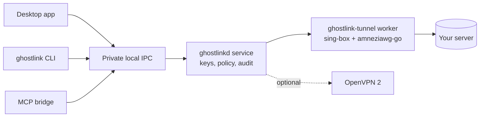

<p align="center"></p>

<h1 align="center">Ghostlink</h1>

<p align="center">A personal, self-hosted VPN client for Windows and Linux.<br>Outline, WireGuard, AmneziaWG and VLESS-REALITY in one app, with split tunneling and a scriptable CLI.</p>

<p align="center"><a href="https://github.com/winyannainghtut/GHOSTLINK/actions/workflows/desktop.yml"></a> <a href="CHANGELOG.md">Changelog</a> · <a href="docs/development/verification.md">What is verified</a> · <a href="docs/security/model.md">Security model</a></p>

> **Pre-release.** Builds are unsigned and intended for personal use and testing. Key handling, the local service, every protocol's encrypted traffic and split-tunnel routing are tested automatically. A full-device VPN session (routes, DNS and IPv6 leak checks) still needs an administrator test machine. See [what is verified](docs/development/verification.md).

## Contents

- [Features](#features)
- [Download and install](#download-and-install)
- [Quick start](#quick-start)
- [Supported keys](#supported-keys)
- [Split tunneling](#split-tunneling)
- [Command line](#command-line)
- [AI agents and MCP](#ai-agents-and-mcp)
- [How it works](#how-it-works)
- [Security and privacy](#security-and-privacy)
- [Running your own server](#running-your-own-server)
- [Building from source](#building-from-source)
- [Status and roadmap](#status-and-roadmap)
- [Documentation](#documentation)
- [License and acknowledgements](#license-and-acknowledgements)

## Features

- **Five ways to connect:** Outline-compatible Shadowsocks, WireGuard, AmneziaWG (obfuscated WireGuard, legacy and 2.0), VLESS with REALITY, and optional OpenVPN.
- **Paste or import any key:** `ss://`, `ssconf://`, `vless://`, Amnezia `vpn://`, and WireGuard/AmneziaWG `.conf` files.
- **Split tunneling:** send listed sites, IP ranges or apps around the VPN (bypass), or only those through it, and keep LAN devices direct. Set it globally or per server.
- **One service, three front ends:** the desktop app, the `ghostlink` CLI and an optional restricted MCP bridge for AI agents all control the same local service.
- **Honest status:** "Connected" means the tunnel was observed up and an HTTPS request through it succeeded. Nothing is reported that was not measured.
- **Safe imports:** script hooks, plaintext VLESS, insecure TLS, obsolete ciphers and Amnezia "full access" keys that carry an SSH login are refused.

## Download and install

Pre-release builds are attached to [GitHub Releases](https://github.com/winyannainghtut/GHOSTLINK/releases) once published. Check every download against `SHA256SUMS.txt`.

| Platform | File | Contents |
|---|---|---|
| Windows 10/11 x64 | `Ghostlink-<version>-windows-x64.msi` | Desktop app, CLI, MCP bridge, tunnel worker and the `Ghostlink` service |
| Windows 10/11 x64 | `Ghostlink-<version>-windows-x64-portable.zip` | The same programs, without installing the service |
| Linux x64 / arm64 | `ghostlink-<version>-linux-<arch>.tar.gz` | CLI, service, MCP bridge, tunnel worker and systemd unit (no desktop app yet) |
| Source | `Ghostlink-<version>-worker-corresponding-source.zip` | GPL source of the tunnel worker |

**Windows.** Install [Microsoft WebView2 Runtime](https://developer.microsoft.com/microsoft-edge/webview2/) if it is not already present, then run the MSI. It needs administrator consent and installs a LocalSystem service that only your Windows account may control. For an unattended install, pass the intended user's SID as `GHOSTLINK_OWNER_SID` ([details](docs/development/windows.md)). Windows SmartScreen warns about unsigned builds.

**Linux.** Unpack the archive and follow its `INSTALL.txt`. You will copy the binaries, install the systemd unit and set `GHOSTLINK_OWNER_UID` to your user ID. Full-tunnel routing is off by default on Linux until you protect your SSH route and enable it ([details](docs/development/linux.md)).

## Quick start

1. Open **Ghostlink** and choose **Add access key**.
2. Paste the key your server owner gave you, or choose **Import a file…** for a WireGuard/AmneziaWG `.conf`.
3. Choose **Connect**. The card shows the protocol, and the panel shows time connected and traffic.

Closing the window keeps Ghostlink in the tray, and the VPN service keeps running. Use **Disconnect** to stop the VPN.

## Supported keys

| Protocol | Import | Notes |
|---|---|---|
| Shadowsocks (Outline) | `ss://`, `ssconf://` | Modern AEAD ciphers only. Dynamic `ssconf://` keys are fetched over verified HTTPS from public hosts, with no redirects. |
| VLESS | `vless://`, Amnezia XRay `vpn://` | REALITY (or TLS) over TCP, with XTLS Vision. Plaintext, insecure TLS, `xhttp` and mKCP are refused. |
| WireGuard | `.conf`, Amnezia `vpn://` | One peer per file. Limited `AllowedIPs` become a split tunnel. |
| AmneziaWG | `.conf`, Amnezia `vpn://` | Legacy and 2.0 parameters (junk packets, header ranges, I1–I5 signature packets, header protection). |
| OpenVPN | `.ovpn` via CLI | Optional, using a separately installed OpenVPN Community. Inline certificates only, strict allowlist. |

`PostUp`/`PreUp` hooks, `Table`, `FwMark` and unknown settings in `.conf` files are rejected. Keys are encrypted by the service (Windows DPAPI) and never shown again in lists, status or logs.

## Split tunneling

Open **Settings → Split tunneling** for all servers, or choose **Split tunneling** in a server's **⋮** menu to override it for that server.

- **Everything uses the VPN** is the default.
- **Bypass**: listed sites (with their subdomains), IP ranges and apps go direct; everything else uses the VPN.
- **Only listed items use the VPN**: the reverse.
- **Keep local network devices off the VPN**: printers, NAS boxes and the like stay reachable.

Changes apply the next time you connect. Sites are matched by name (TLS SNI, HTTP Host, QUIC and DNS), so an app that hides the name, for example with ECH or hard-coded IPs, can still use the VPN. Bypassed traffic deliberately leaves the tunnel. The connection health check always goes through the VPN, so a broken tunnel can never be reported as connected. OpenVPN profiles ignore split tunneling.

## Command line

The CLI talks to the same service as the app. Keys are read from a file or stdin, never from a command argument.

| Task | Command |
|---|---|
| Add a key | `ghostlink key add --name tokyo --file tokyo.txt` (or `--stdin`; `--replace` to overwrite) |
| Import a `.conf` / `.ovpn` | `ghostlink profile import home.conf --name home` |
| List, set default, remove | `ghostlink profile list` · `profile default tokyo` · `profile remove tokyo` |
| Connect, switch, disconnect | `ghostlink connect --profile tokyo` · `switch --profile home` · `disconnect` |
| Status and diagnostics | `ghostlink status` · `info` · `doctor` · `logs --tail 100` |
| Split tunneling | `ghostlink split set --mode bypass --site netflix.com --ip 192.168.1.0/24 --app steam.exe --lan-direct` · `split show` · `split clear` (add `--profile NAME` for one server) |
| Start-up connection | `ghostlink autoconnect enable` / `disable` |

Add `--json` for a versioned machine-readable envelope ([CLI contract](docs/development/cli-contract.md)). `connect` waits until the tunnel is verified; `--no-wait` returns immediately. Exit codes: 0 ok, 1 connection/internal failure, 2 invalid input, 3 permission denied, 4 service or engine unavailable, 5 timeout, 6 busy, 130 interrupted.

## AI agents and MCP

```powershell
ghostlink agent grant --name assistant --token-file C:\private\assistant.token
ghostlink-mcp --token-file C:\private\assistant.token
```

A grant is read-only: profiles, status and diagnostics. Add `--control` to the grant **and** `--allow-control` to the bridge to allow connect, disconnect and switch. Agents can never import keys, change split tunneling or issue grants. Revoke with `ghostlink agent revoke --name assistant`. Tokens are written to a new private file and never printed. A token limits what an agent can ask the service to do; it is not a sandbox against other programs running as your user.

## How it works



- **Unprivileged front ends.** The app, CLI and MCP bridge run as you; only the service holds network privileges.
- **One tunnel engine.** The managed worker links unmodified [sing-box](https://github.com/SagerNet/sing-box) 1.14.4 for the TUN adapter, routing, DNS, Shadowsocks, VLESS and WireGuard, and unmodified [amneziawg-go](https://github.com/amnezia-vpn/amneziawg-go) for AmneziaWG. Ghostlink implements no encryption of its own.
- **Lifecycle.** The service generates each tunnel's configuration privately, verifies it, starts the worker and stops it gracefully. If the service dies, the worker shuts down on its own.

More: [protocol design](docs/architecture/protocols.md) · [architecture record](docs/architecture/decision-record.md).

## Security and privacy

- **Local control:** a named pipe (Windows) or Unix socket restricted to SYSTEM/root and the one authorized user. Clients verify the service's identity.
- **Credentials:** encrypted at rest. Keys never appear in process arguments, lists, status or audit logs, and agent fingerprints are salted.
- **Imports:** strict allowlist parsing everywhere; no imported setting can run a command.
- **Network health:** "connected" requires an observed tunnel interface and a successful HTTPS check through it. A cleanup failure blocks the next connection until it is investigated.
- **Not yet provided:** a persistent kill switch, an approval queue for agent actions, and signed builds.

Details: [security model](docs/security/model.md) · [dependency scans](docs/security/dependencies.md) · [licensing](docs/security/licensing.md).

## Running your own server

- **Now:** [an Outline-compatible Shadowsocks server](docs/deployment/outline-server.md) generated offline and deployed with systemd/Ansible, plus an optional OpenVPN PKI tool.
- **Coming in v0.3.0:** a Ghostlink server packaged as `.deb`/`.rpm` with its Docker image included. It runs AmneziaWG, WireGuard, VLESS-REALITY and Shadowsocks, prints a management key like Outline's, and lets the app create users and keys and set per-user or global traffic rules (block sites, IPs, ports or BitTorrent; data limits).

## Building from source

**Windows** needs Rust 1.92+, MSVC Build Tools with the Windows SDK, Go (the pinned 1.26.10 toolchain downloads automatically), Node.js and WebView2 Runtime.

```powershell
./scripts/bootstrap-windows.ps1 -IncludeSdk          # pinned WiX (+ SDK); installs nothing system-wide
./scripts/cargo.ps1 build --locked --workspace
Push-Location core/outline-worker
go build -mod=readonly -trimpath -tags with_gvisor,with_utls,with_wireguard -o ..\..\target\debug\ghostlink-tunnel.exe .
Pop-Location
./scripts/cargo.ps1 build --locked --manifest-path apps/desktop/src-tauri/Cargo.toml
./scripts/build-windows.ps1                           # optimized MSI + portable ZIP
```

**Linux** needs Rust, Go, `pkg-config` and `libssl-dev`. Run `bash scripts/build-linux.sh` to produce `artifacts/linux-<arch>/ghostlink-<version>-linux-<arch>.tar.gz`.

**Tests.**

```powershell
./scripts/cargo.ps1 test --locked --workspace         # Rust unit tests
npm ci --ignore-scripts; npm test                      # service/CLI/MCP process tests
cd core/outline-worker; go test -tags with_gvisor,with_utls,with_wireguard ./...   # engine + interop
```

Real-engine traffic tests are opt-in and need the built worker; see the [verification ledger](docs/development/verification.md). Releases are built by GitHub Actions from a `v<version>` tag ([release process](docs/development/releases.md)).

## Status and roadmap

| Area | Status |
|---|---|
| Windows app, service, CLI, MCP | Built and packaged (MSI); installer and full-device routing need an administrator test |
| Protocols | Shadowsocks, VLESS-REALITY, WireGuard, AmneziaWG: encrypted traffic tested against upstream implementations. OpenVPN: optional |
| Split tunneling | Routing rules tested in the real engine; app matching and full-device behavior need an elevated test |
| Linux | CLI/service/worker build and tests pass in CI; runtime not yet verified on a real host; no desktop app yet |
| Ghostlink server + management from the app | In progress (v0.3.0) |
| macOS, Android, iOS | Not started |

The [changelog](CHANGELOG.md) lists what each release changed.

## Documentation

| Topic | Document |
|---|---|
| What changed | [CHANGELOG.md](CHANGELOG.md) |
| What is verified | [docs/development/verification.md](docs/development/verification.md) |
| CLI / IPC contract | [docs/development/cli-contract.md](docs/development/cli-contract.md) |
| Windows and Linux setup | [windows.md](docs/development/windows.md) · [linux.md](docs/development/linux.md) |
| Releases | [docs/development/releases.md](docs/development/releases.md) |
| Protocol design | [docs/architecture/protocols.md](docs/architecture/protocols.md) |
| Security, dependencies, licensing | [model.md](docs/security/model.md) · [dependencies.md](docs/security/dependencies.md) · [licensing.md](docs/security/licensing.md) |
| Server deployment | [docs/deployment/outline-server.md](docs/deployment/outline-server.md) |
| Developer / AI-agent handover | [agent.md](agent.md) · [devjourney.md](devjourney.md) |

## License and acknowledgements

Ghostlink's Rust service, CLI, MCP bridge and desktop UI are [MIT](LICENSE). The separate tunnel worker (`core/outline-worker`) links GPL-3.0-or-later sing-box and is GPL-3.0-or-later; its corresponding source is published with every release. Dependencies and embedded drivers keep their own terms; see [NOTICE.md](NOTICE.md) and [licensing notes](docs/security/licensing.md).

Ghostlink builds on [sing-box](https://github.com/SagerNet/sing-box), [amneziawg-go](https://github.com/amnezia-vpn/amneziawg-go), [Wintun](https://www.wintun.net/), [Tauri](https://tauri.app/) and others, and is compatible with keys from [Outline](https://getoutline.org/) and [Amnezia](https://amnezia.org/). It is an independent project, not affiliated with or endorsed by any of them. "WireGuard" is a registered trademark of Jason A. Donenfeld.
