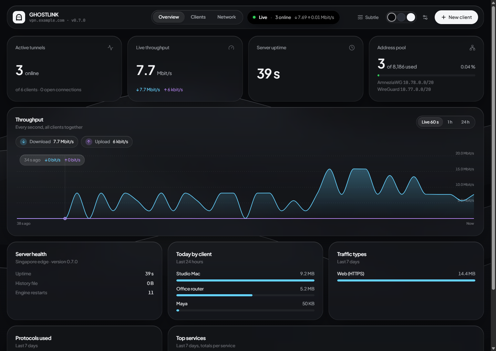
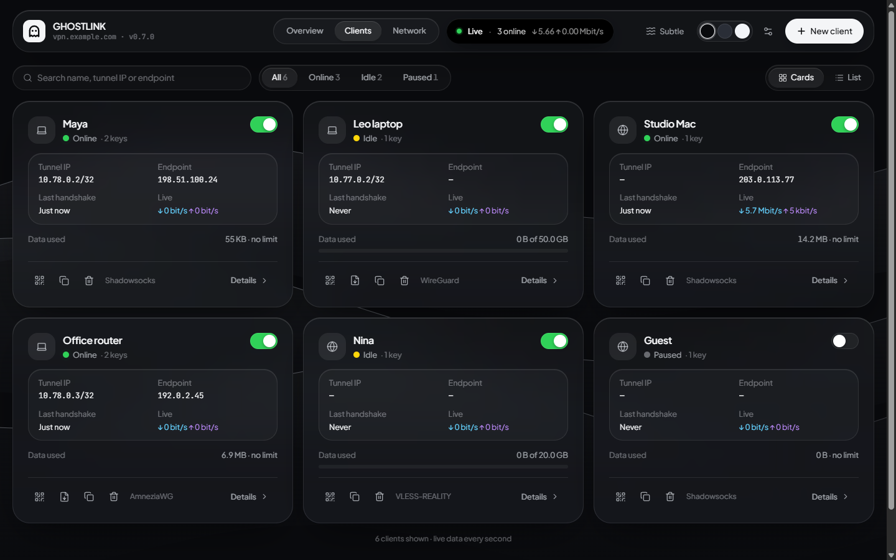
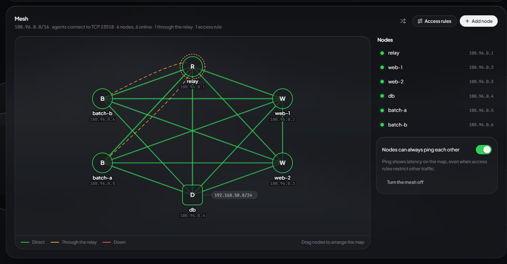
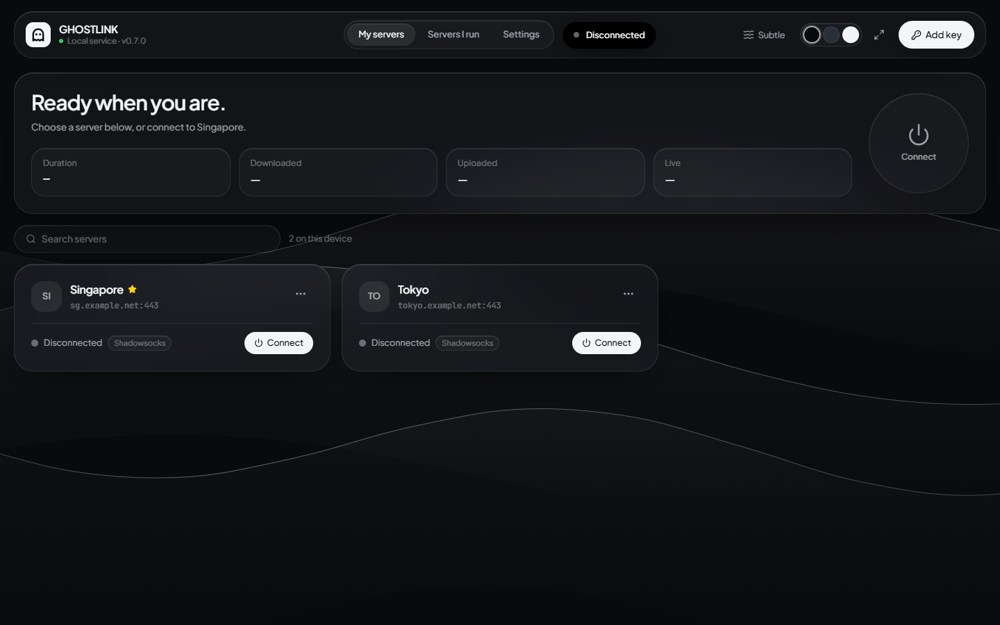
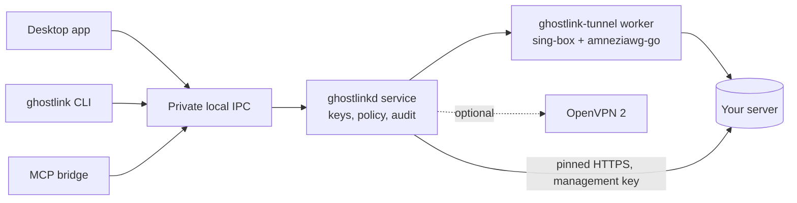

<p align="center"></p>

<h1 align="center">Ghostlink</h1>

<p align="center">A personal, self-hosted VPN for Windows and Linux: one app to run your own server and to connect to it.<br>Outline, WireGuard, AmneziaWG and VLESS-REALITY, with split tunneling, per-user traffic rules and speed limits, and a scriptable CLI.</p>

<p align="center"><a href="https://github.com/winyannainghtut/GHOSTLINK/actions/workflows/desktop.yml"></a> <a href="CHANGELOG.md">Changelog</a> · <a href="docs/development/verification.md">What is verified</a> · <a href="docs/security/model.md">Security model</a></p>

> **Pre-release.** Builds are unsigned and intended for personal use and testing. Key handling, the local service, every protocol's encrypted traffic and split-tunnel routing are tested automatically. A full-device VPN session (routes, DNS and IPv6 leak checks) still needs an administrator test machine. See [what is verified](docs/development/verification.md).

<p align="center"></p>

<table>
  <tr>
    <td width="33%"></td>
    <td width="33%"></td>
    <td width="33%"></td>
  </tr>
  <tr>
    <td align="center"><sub>Clients</sub></td>
    <td align="center"><sub>Mesh of Linux servers</sub></td>
    <td align="center"><sub>Desktop app</sub></td>
  </tr>
</table>

<p align="center"><sub>The server dashboard and the desktop app share one frosted-glass interface (Obsidian finish shown; Titanium and Daylight are built in). Example data from a local test server.</sub></p>

## Contents

- [Features](#features)
- [Download and install](#download-and-install)
- [Quick start](#quick-start)
- [Supported keys](#supported-keys)
- [Split tunneling](#split-tunneling)
- [Command line](#command-line)
- [AI agents and MCP](#ai-agents-and-mcp)
- [How it works](#how-it-works)
- [Security and privacy](#security-and-privacy)
- [Running your own server](#running-your-own-server)
- [Mesh of servers](#mesh-of-servers)
- [Building from source](#building-from-source)
- [Status and roadmap](#status-and-roadmap)
- [Documentation](#documentation)
- [License and acknowledgements](#license-and-acknowledgements)

## Features

- **Five ways to connect:** Outline-compatible Shadowsocks, WireGuard, AmneziaWG (obfuscated WireGuard, legacy and 2.0), VLESS with REALITY, and optional OpenVPN.
- **Paste or import any key:** `ss://`, `ssconf://`, `vless://`, Amnezia `vpn://`, and WireGuard/AmneziaWG `.conf` files.
- **Split tunneling:** send listed sites, IP ranges or apps around the VPN (bypass), or only those through it, and keep LAN devices direct. Set it globally or per server.
- **One service, three front ends:** the desktop app, the `ghostlink` CLI and an optional restricted MCP bridge for AI agents all control the same local service.
- **Your own server, Outline-style:** install one `.deb`/`.rpm` on a Linux machine with Docker (the image is inside the package), paste the management key it prints into the app, then create users and keys and set traffic rules from **Servers I run** or `ghostlink server`.
- **Server traffic rules:** block sites, IP ranges, ports, BitTorrent or outgoing mail for everyone or per user; data limits and usage per user; local networks and the server itself are always off-limits to VPN users.
- **Speed limits:** one cap per client in MB/s, download and upload alike, across all its devices (IKEv2/IPsec sessions have a budget of their own), with an optional default for everyone. Changes apply live, on every protocol, without disconnecting anyone.
- **Move from Outline:** one command takes over an Outline server on the same machine; every access key becomes a client and the `ss://` keys people already have keep working.
- **Server monitoring:** live speed per user, who is online, traffic types (web, video/QUIC, calls, BitTorrent…), protocols used, optional top services, connection addresses and server health. History rotates itself so it never fills the disk.
- **iPhone, iPad and Mac with no app:** the server can also serve Apple's built-in IKEv2 and IPsec VPN, and hands each person a configuration profile (`.mobileconfig`) that installs it in Settings. Sign-in is by password or certificate.
- **Mesh of your Linux servers:** a private network between your servers over WireGuard: direct links with a relay for servers behind NAT, tag-based access rules, shared subnets, and a live map in the app and the dashboard. One command adds a server.
- **Three ways to manage your server:** the app, `sudo ghostlink-server …` commands on the server (with QR codes in the terminal and a live `top`), or a web dashboard on its own port (private behind an SSH tunnel by default).
- **Easy sharing:** QR codes for every key and a one-page connection kit per person, for the Outline, WireGuard, AmneziaVPN and v2ray-family apps on any phone.
- **Frosted-glass design:** the desktop app and the server dashboard share one interface: translucent surfaces over slow glass waves (Subtle, Calm or Still), in three finishes (Obsidian, Titanium, Daylight), with live numbers that never jitter.
- **Honest status:** "Connected" means the tunnel was observed up and an HTTPS request through it succeeded. Nothing is reported that was not measured.
- **Safe imports:** script hooks, plaintext VLESS, insecure TLS, obsolete ciphers and Amnezia "full access" keys that carry an SSH login are refused.

## Download and install

Pre-release builds are attached to [GitHub Releases](https://github.com/winyannainghtut/GHOSTLINK/releases) once published. Check every download against `SHA256SUMS.txt`.

| Platform | File | Contents |
|---|---|---|
| Windows 10/11 x64 | `Ghostlink-<version>-windows-x64.msi` | Desktop app, CLI, MCP bridge, tunnel worker and the `Ghostlink` service |
| Windows 10/11 x64 | `Ghostlink-<version>-windows-x64-portable.zip` | The same programs, without installing the service |
| Linux x64 / arm64 (Debian, Ubuntu) | `ghostlink_<version>-1_<amd64\|arm64>.deb` | CLI, service, MCP bridge and tunnel worker (no desktop app yet) |
| Linux x64 / arm64 (Fedora, RHEL family) | `ghostlink-<version>-1.<x86_64\|aarch64>.rpm` | The same, as an RPM |
| Linux x64 / arm64 (any) | `ghostlink-<version>-linux-<arch>.tar.gz` | The same files for a manual install |
| Server, Debian/Ubuntu (x64, arm64) | `ghostlink-server_<version>-1_<amd64\|arm64>.deb` | The Ghostlink server with its Docker image included ([guide](docs/deployment/ghostlink-server.md)) |
| Server, Fedora/RHEL family (x64, arm64) | `ghostlink-server-<version>-1.<x86_64\|aarch64>.rpm` | The same, as an RPM |
| Mesh agent, Debian/Ubuntu or Fedora/RHEL (x64, arm64) | `ghostlink-mesh_<version>-1_<arch>.deb`, `ghostlink-mesh-<version>-1.<arch>.rpm` | Joins a Linux server to a Ghostlink mesh; usually installed by the app's one-line **Add node** command ([guide](docs/deployment/mesh.md)) |
| Source | `Ghostlink-<version>-worker-corresponding-source.zip` | GPL source of the tunnel worker, the server and the mesh agent |
| Source | `Ghostlink-<version>-ipsec-component-source-<x64\|arm64>.tar.gz` | GPL source of strongSwan, iptables and the other copyleft packages in the server's IPsec image |

**Windows.** Install [Microsoft WebView2 Runtime](https://developer.microsoft.com/microsoft-edge/webview2/) if it is not already present, then run the MSI. It needs administrator consent and installs a LocalSystem service that only your Windows account may control. For an unattended install, pass the intended user's SID as `GHOSTLINK_OWNER_SID` ([details](docs/development/windows.md)); installing a newer version with it later changes the owner. Open **Ghostlink** from the Start menu or the desktop shortcut. Windows SmartScreen warns about unsigned builds. Use v0.3.1 or later on Windows: in earlier installers, the app could not reach the installed service.

**Linux.** Install the package for your distribution with `sudo`. It sets you as the owner and starts the `ghostlinkd` service:

```sh
sudo apt install ./ghostlink_<version>-1_amd64.deb       # Debian / Ubuntu
sudo dnf install ./ghostlink-<version>-1.x86_64.rpm      # Fedora / RHEL family
ghostlink status
```

Full-tunnel routing is off on Linux until you add `GHOSTLINK_FLAGS=--allow-full-tunnel` to `/etc/ghostlink/ghostlinkd.env` and restart the service. That covers Shadowsocks and VLESS keys, OpenVPN profiles that redirect the gateway, and WireGuard/AmneziaWG profiles whose `AllowedIPs` cover every public IPv4 address, also in pieces such as `0.0.0.0/1, 128.0.0.0/1`. Protect your SSH access first if the machine is remote. The `.tar.gz` contains the same files plus an `INSTALL.txt` for a manual install ([details](docs/development/linux.md)).

## Quick start

1. Open **Ghostlink** and choose **Add access key**.
2. Paste the key your server owner gave you, or choose **Import a .conf file** for a WireGuard/AmneziaWG `.conf`.
3. Choose **Connect**. The card shows the protocol, and the panel shows time connected and traffic.

Closing the window keeps Ghostlink in the tray, and the VPN service keeps running. Use **Disconnect** to stop the VPN.

## Supported keys

| Protocol | Import | Notes |
|---|---|---|
| Shadowsocks (Outline) | `ss://`, `ssconf://` | Modern AEAD ciphers only. Dynamic `ssconf://` keys are fetched over verified HTTPS from public hosts, with no redirects. |
| VLESS | `vless://`, Amnezia XRay `vpn://` | REALITY (or TLS) over TCP, with XTLS Vision. Plaintext, insecure TLS, `xhttp` and mKCP are refused. |
| WireGuard | `.conf`, Amnezia `vpn://` | One peer per file. Limited `AllowedIPs` become a split tunnel, but such a profile cannot pass the connection check through the tunnel yet, so it fails after the connection timeout (keys from a Ghostlink server route everything). |
| AmneziaWG | `.conf`, Amnezia `vpn://` | Legacy and 2.0 parameters (junk packets, header ranges, I1–I5 signature packets, header protection). |
| OpenVPN | `.ovpn` via CLI | Optional, using a separately installed OpenVPN Community. Inline certificates only, strict allowlist. |

`PostUp`/`PreUp` hooks, `Table`, `FwMark` and unknown settings in `.conf` files are rejected. Keys are encrypted by the service (Windows DPAPI) and never shown again in lists, status or logs.

## Split tunneling

Open **Settings → Split tunneling** for all servers, or choose **Split tunneling** in a server's **⋮** menu to override it for that server.

- **Everything uses the VPN** is the default.
- **Bypass**: listed sites (with their subdomains), IP ranges and apps go direct; everything else uses the VPN.
- **Only listed items use the VPN**: the reverse.
- **Keep local network devices off the VPN**: printers, NAS boxes and the like stay reachable.

Changes apply the next time you connect. Sites are matched by name (TLS SNI, HTTP Host, QUIC and DNS), so an app that hides the name, for example with ECH or hard-coded IPs, can still use the VPN. Bypassed traffic deliberately leaves the tunnel. The connection health check always goes through the VPN, so a broken tunnel can never be reported as connected. OpenVPN profiles ignore split tunneling.

## Command line

The CLI talks to the same service as the app. Keys are read from a file or stdin, never from a command argument.

| Task | Command |
|---|---|
| Add a key | `ghostlink key add --name tokyo --file tokyo.txt` (or `--stdin`; `--replace` to overwrite) |
| Import a `.conf` / `.ovpn` | `ghostlink profile import home.conf --name home` |
| List, set default, remove | `ghostlink profile list` · `profile default tokyo` · `profile remove tokyo` |
| Connect, switch, disconnect | `ghostlink connect --profile tokyo` · `switch --profile home` · `disconnect` |
| Status and diagnostics | `ghostlink status` · `info` · `doctor` · `logs --tail 100` |
| Split tunneling | `ghostlink split set --mode bypass --site netflix.com --ip 192.168.1.0/24 --app steam.exe --lan-direct` · `split show` · `split clear` (add `--profile NAME` for one server) |
| Start-up connection | `ghostlink autoconnect enable` / `disable` |
| Manage your server | `ghostlink server add --name home --key-file key.json` · `server users add --server home --name Alice` · `server keys create --server home --user 1 --protocol shadowsocks --import alice` · `server rules set --server home --block-site ads.example` · `server usage --server home` (`ghostlink server install-help` for setup) |
| Monitor and share | `ghostlink server live --server home` · `server stats --server home --user 1 --range 7d` · `server clients --server home` · `server keys qr --server home --user 1 --key 2` · `server keys kit --server home --user 1 --output alice.html` |

Add `--json` for a versioned machine-readable envelope ([CLI contract](docs/development/cli-contract.md)). `connect` waits until the tunnel is verified; `--no-wait` returns immediately. Exit codes: 0 ok, 1 connection/internal failure, 2 invalid input, 3 permission denied, 4 service or engine unavailable, 5 timeout, 6 busy, 130 interrupted.

## AI agents and MCP

```powershell
ghostlink agent grant --name assistant --token-file C:\private\assistant.token
ghostlink-mcp --token-file C:\private\assistant.token
```

A grant is read-only: profiles, status and diagnostics. Add `--control` to the grant **and** `--allow-control` to the bridge to allow connect, disconnect and switch. Agents can never import keys, change split tunneling, manage servers or issue grants. Revoke with `ghostlink agent revoke --name assistant` (a name with no grant is an error, so a typo cannot look like success). Tokens are written to a new private file and never printed; to change a grant, issue it again into a new token file. A token limits what an agent can ask the service to do; it is not a sandbox against other programs running as your user.

## How it works



- **Unprivileged front ends.** The app, CLI and MCP bridge run as you; only the service holds network privileges.
- **One tunnel engine.** The managed worker links unmodified [sing-box](https://github.com/SagerNet/sing-box) 1.14.4 for the TUN adapter, routing, DNS, Shadowsocks, VLESS and WireGuard, and unmodified [amneziawg-go](https://github.com/amnezia-vpn/amneziawg-go) for AmneziaWG. Ghostlink implements no encryption of its own.
- **Lifecycle.** The service generates each tunnel's configuration privately, verifies it, starts the worker and stops it gracefully. If the service dies, the worker shuts down on its own.
- **Your server.** `ghostlink-server` runs the same unmodified engines in a hardened container, with an HTTPS management API. The service talks to it with the certificate pinned inside the TLS handshake, so the secret API path never reaches anyone else.

More: [protocol design](docs/architecture/protocols.md) · [original architecture record (OpenVPN era)](docs/architecture/decision-record.md).

## Security and privacy

- **Local control:** a named pipe (Windows) or Unix socket restricted to SYSTEM/root and the one authorized user. Clients check who created the pipe before sending anything.
- **Credentials:** on Windows, encrypted at rest with DPAPI under the service's identity, in storage only the service can read. On Linux they are not encrypted: they are kept in root-only files (mode 0600 in a 0700 directory), with no OS vault yet. Keys never appear in process arguments, lists, status or audit logs, and agent fingerprints are salted. Server management keys are kept the same way and are owner-only.
- **Imports:** strict allowlist parsing everywhere; no imported setting can run a command.
- **Network health:** "connected" requires a tunnel address the worker observed on the interface and a successful HTTPS check through the tunnel (optional OpenVPN profiles: OpenVPN's own connected event with a valid address). A cleanup failure blocks the next connection until the service restarts.
- **Not yet provided:** a persistent kill switch, an approval queue for agent actions, and signed builds.

Details: [security model](docs/security/model.md) · [dependency scans](docs/security/dependencies.md) · [licensing](docs/security/licensing.md).

## Running your own server

**The Ghostlink server** can run Shadowsocks (Outline-compatible), AmneziaWG, WireGuard and VLESS-REALITY in one hardened Docker container on Linux (x64 or arm64). A new server runs only Outline-compatible Shadowsocks: the other three have their ports and keys ready but stay off until you turn them on (their switch in the app or the dashboard, or `sudo ghostlink-server set --enable amneziawg`), which prints the port to allow in your firewall. A server you already run keeps the protocols it has on. Since v0.5.0 it can also run IKEv2/IPsec for Apple devices in an optional second container. The package carries both images, so nothing is downloaded from a registry:

```sh
curl -fsSL https://raw.githubusercontent.com/winyannainghtut/GHOSTLINK/main/scripts/install-server.sh | sudo bash
# options: --hostname YOUR_PUBLIC_IP_OR_NAME  --enable amneziawg|wireguard|vless  --ipsec (iPhone/iPad/Mac)  --mesh (mesh of servers)  --open-firewall  --add-swap  --help
```

**Already running Outline?** Take it over on the same machine; its `ss://` keys keep working ([guide](docs/deployment/migrate-from-outline.md)):

```sh
curl -fsSL https://raw.githubusercontent.com/winyannainghtut/GHOSTLINK/main/scripts/install-server.sh | sudo bash -s -- --migrate-outline --check   # see what would happen
curl -fsSL https://raw.githubusercontent.com/winyannainghtut/GHOSTLINK/main/scripts/install-server.sh | sudo bash -s -- --migrate-outline
```

Every access key becomes a client with the same password, port and cipher, plus its name and data limit, also keys on ports below 1024 such as 443 (from 0.8.4 on). A key that can't be kept gets a new key, which the check lists. If anything fails, or the command is interrupted, Outline is put back as it was, unless the import was already saved: then Ghostlink keeps the clients and Outline stays stopped. On a server with under 900 MB of memory and swap, add `--add-swap`.

The installer picks the right package for Debian/Ubuntu or Fedora/RHEL on x86_64 or arm64, installs Docker if needed, verifies the download's checksum, and prints the management key and the ports to open. Run it again to upgrade. You can also install a downloaded package by hand: `sudo apt install ./ghostlink-server_<version>-1_amd64.deb`, or the `.rpm` with `dnf`. `sudo ghostlink-server show-key` prints the key again.

Paste the key into **Servers I run → Add server** (or `ghostlink server add`). You can also manage everything on the server itself (`sudo ghostlink-server users`, `key add`, `top`…) or in its web dashboard (`sudo ghostlink-server dashboard`). From there:
- **Users:** add users, with optional data limits and speed limits (MB/s, or a default for everyone).
- **Keys:** issue keys for each protocol that is on. You can copy them, share a `.conf` for WireGuard/AmneziaWG apps, or use one on this device.
- **Rules:** block sites, IPs, ports, BitTorrent or outgoing mail for everyone or for one user.
- **Usage and monitoring:** see live speeds, who is online, data used, traffic types and, if you turn it on, each user's top services.
- **Sharing:** show a key's QR code, or save a connection kit page for each person.
- **iPhone, iPad, Mac:** run `sudo ghostlink-server ipsec enable` once, open UDP 500 and 4500, and turn the protocols on with `sudo ghostlink-server set --enable ikev2` (and/or `--enable ipsec`) or their switch in the app or dashboard; the installer's `--ipsec` does all of this. Then create IKEv2 (or IPsec) keys and save each as a profile to send.

Upgrading the package keeps everything. Full guide: [Ghostlink server](docs/deployment/ghostlink-server.md).

## Mesh of servers

New in 0.6.0: your Ghostlink server can coordinate a **mesh**, a private network between your Linux servers. Each server you add gets a mesh address (`100.96.x.x`) and the name `<server>.mesh`, and reaches the others over kernel WireGuard wherever they run.

- **Connections:** pairs connect directly. Two servers behind NAT usually go through a relay (your own server), and switch to a direct path as soon as one works.
- **Access rules:** tags such as `web → db TCP 5432` limit what may connect.
- **Shared subnets:** a server can share the private network behind it after you approve it.

```sh
# on the Ghostlink server: coordinate the mesh and join it as the relay
curl -fsSL https://raw.githubusercontent.com/winyannainghtut/GHOSTLINK/main/scripts/install-server.sh | sudo bash -s -- --mesh
# in the app: Servers I run → Manage → Network → Mesh → Add node, then run the command it gives on each server:
curl -fsSL https://raw.githubusercontent.com/winyannainghtut/GHOSTLINK/main/scripts/install-mesh.sh | sudo bash -s -- --join 'glmesh1:…'
```

The **Mesh** card in the **Network** view, in the app (**Servers I run → Manage**) and in the dashboard, shows every node and link: direct or through the relay, with latency and traffic. From the map you can approve servers, set tags, subnets and the relay, edit access rules, and disable or remove servers. The same is available with `sudo ghostlink-server mesh …` and `ghostlink server mesh …`.

Mesh nodes are Linux servers in this version; Windows servers and the Ghostlink app on Windows will follow. Guide: [Ghostlink mesh](docs/deployment/mesh.md).

Also available: the earlier [offline Outline-compatible proxy](docs/deployment/outline-server.md), a plain Shadowsocks server with static keys deployed with systemd/Ansible (use the Ghostlink server for new servers), and an optional OpenVPN PKI tool.

## Building from source

**Windows** needs Rust 1.92+, MSVC Build Tools with the Windows SDK, Go (the pinned 1.26.10 toolchain downloads automatically), Node.js and WebView2 Runtime.

```powershell
./scripts/bootstrap-windows.ps1 -IncludeSdk          # pinned WiX (+ SDK); installs nothing system-wide
./scripts/cargo.ps1 build --locked --workspace
Push-Location core/outline-worker
go build -mod=readonly -trimpath -tags with_gvisor,with_utls,with_wireguard -o ..\..\target\debug\ghostlink-tunnel.exe .
Pop-Location
./scripts/cargo.ps1 build --locked --manifest-path apps/desktop/src-tauri/Cargo.toml
./scripts/build-windows.ps1                           # optimized MSI + portable ZIP
```

**Linux** needs Rust, Go, `pkg-config` and `libssl-dev`, plus [nfpm](https://nfpm.goreleaser.com/) 2.48 for packages (`go install github.com/goreleaser/nfpm/v2/cmd/nfpm@v2.48.0`). Run `bash scripts/build-linux.sh` to produce the client `.tar.gz`, `.deb` and `.rpm`, `bash scripts/build-linux-server.sh` (also needs Docker) for the server image and its `.deb`/`.rpm`, and `bash scripts/build-linux-mesh.sh` for the mesh agent's `.deb`/`.rpm`, all under `artifacts/linux-<arch>/`. `sudo bash tests/mesh/e2e.sh DIR` runs the mesh end-to-end test (see `.github/workflows/mesh.yml`).

**Web UI.** The desktop app's interface and the server dashboard are built from `ui/` (React, TypeScript, Tailwind CSS, Lucide) with Node.js 22. The builds are committed, so the steps above need no Node. After changing `ui/`:

```sh
cd ui && npm ci --ignore-scripts && npm run build && npm test
```

See [ui/README.md](ui/README.md).

**Tests.**

```powershell
./scripts/cargo.ps1 test --locked --workspace         # Rust unit tests
npm ci --ignore-scripts; npm test                      # service/CLI/MCP process tests
cd core/outline-worker; go test -tags with_gvisor,with_utls,with_wireguard ./...   # engine + interop
```

Real-engine traffic tests are opt-in and need the built worker; see the [verification ledger](docs/development/verification.md). Releases are built by GitHub Actions from a `v<version>` tag ([release process](docs/development/releases.md)).

## Status and roadmap

| Area | Status |
|---|---|
| Windows app, service, CLI, MCP | Built and packaged (MSI); installer and full-device routing need an administrator test |
| Protocols | Shadowsocks, VLESS-REALITY, WireGuard, AmneziaWG: encrypted traffic tested against upstream implementations. OpenVPN: optional |
| Split tunneling | Routing rules tested in the real engine; app matching and full-device behavior need an elevated test |
| Linux | CLI/service/worker build and tests pass in CI; release CI installs the `.deb` and checks the service runs; a full VPN session is not yet verified on a real host; no desktop app yet |
| Ghostlink server, management, monitoring | Server API, rules, data and speed limits, monitoring and all four protocols tested end to end with real clients; the Outline import tested with Outline's own keys and, in release CI, with a fake Outline on the host; server commands and dashboard tested; release CI installs the server `.deb` with Docker and exercises API, commands and dashboard; on an internet-facing test VPS (AWS Lightsail, 2026-11-08) all four protocols carried real traffic and the isolation, limits, rules, online state, commands, statistics, restart and dashboard passed; IKEv2/IPsec, the mesh and the move from Outline are not yet verified on a real host |
| IKEv2/IPsec for iPhone, iPad, Mac | Profiles and server checked by unit tests. CI connects a real strongSwan client with each profile's parameters (all four sign-in methods) through the packaged component, and measures a capped download at its speed limit. Installing and connecting a profile on a real iPhone, iPad or Mac is not verified yet: it needs a check by hand on a device |
| Mesh of Linux servers | Tested in CI with kernel WireGuard between network namespaces: direct and relayed paths through NAT, access rules, shared subnets, names, disable/remove and clean-up. Release CI installs the agent package, joins it to the installed server and removes it cleanly. Not yet run across real cloud servers. Windows nodes are planned |
| Ghostlink apps for macOS, Android, iOS | Not started (Apple devices use the built-in VPN with profiles; other phones use the third-party apps listed above) |

**Latest release:** v0.8.3, a pre-release (2026-11-09): new servers run only Shadowsocks (Outline-compatible) until you turn on another protocol. 0.8.2 brought layout fixes, and 0.8.1 the fixes for 0.8.0 from a report on a running server and two reviews of the code. The [changelog](CHANGELOG.md) lists what each release changed; its 0.8.1 section also says what behaves differently after an upgrade from 0.8.0. The first non-pre-release, v1.0.0, waits for signed builds or a decision to launch unsigned, and for real-device checks of the Windows installer, a VPS server and an Apple device.

## Documentation

| Topic | Document |
|---|---|
| What changed | [CHANGELOG.md](CHANGELOG.md) |
| What is verified | [docs/development/verification.md](docs/development/verification.md) |
| CLI / IPC contract | [docs/development/cli-contract.md](docs/development/cli-contract.md) |
| Windows and Linux setup | [windows.md](docs/development/windows.md) · [linux.md](docs/development/linux.md) |
| Releases | [docs/development/releases.md](docs/development/releases.md) |
| Protocol design | [docs/architecture/protocols.md](docs/architecture/protocols.md) |
| Security, dependencies, licensing | [model.md](docs/security/model.md) · [dependencies.md](docs/security/dependencies.md) · [licensing.md](docs/security/licensing.md) |
| Ghostlink server | [docs/deployment/ghostlink-server.md](docs/deployment/ghostlink-server.md) |
| Move from Outline | [docs/deployment/migrate-from-outline.md](docs/deployment/migrate-from-outline.md) |
| Mesh of Linux servers | [docs/deployment/mesh.md](docs/deployment/mesh.md) |
| Earlier offline Outline-compatible proxy | [docs/deployment/outline-server.md](docs/deployment/outline-server.md) |
| Web UI (dashboard and desktop) | [ui/README.md](ui/README.md) |
| Developer / AI-agent handover | [agent.md](agent.md) |

## License and acknowledgements

Ghostlink's Rust service, CLI, MCP bridge and web UI (`ui/`, the desktop app's interface and the dashboard's source) are [MIT](LICENSE). The separate tunnel worker, the Ghostlink server and the mesh agent (`core/outline-worker`) are GPL-3.0-or-later (the worker and server link GPL-3.0-or-later sing-box); their corresponding source is published with every release. Dependencies and embedded drivers keep their own terms; see [NOTICE.md](NOTICE.md) and [licensing notes](docs/security/licensing.md).

Ghostlink builds on [sing-box](https://github.com/SagerNet/sing-box), [amneziawg-go](https://github.com/amnezia-vpn/amneziawg-go), [Wintun](https://www.wintun.net/), [Tauri](https://tauri.app/) and others, and is compatible with keys from [Outline](https://getoutline.org/) and [Amnezia](https://amnezia.org/). It is an independent project, not affiliated with or endorsed by any of them. "WireGuard" is a registered trademark of Jason A. Donenfeld.
