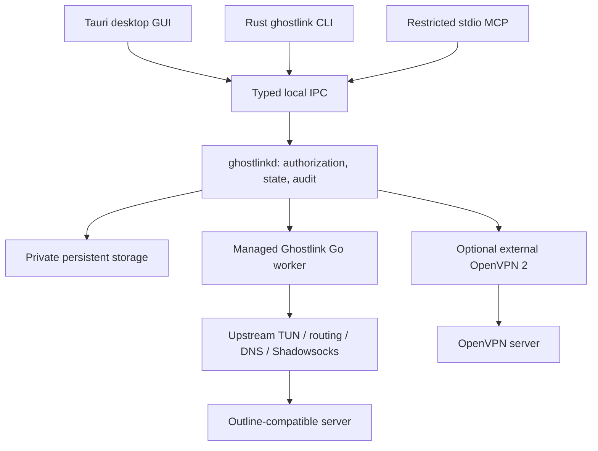

# Ghostlink — AI agent project handover

Updated: **2026-11-06, Asia/Singapore**. Current release: **v0.3.0** (Ghostlink server and server management; v0.2.1 added Linux client packages); the original implementation baseline was `7c875ad`. See [CHANGELOG.md](CHANGELOG.md) for what each version changed. Use `git log -1` and the current files to identify later changes.

> **Renamed MyVPN → Ghostlink (2026-11-06).** Every binary, crate, service, pipe, path, environment variable and UI string now uses Ghostlink: `ghostlink`, `ghostlinkd`, `ghostlink-mcp`, `ghostlink-tunnel`, `ghostlink-desktop`; service `Ghostlink`; pipe `\\.\pipe\ghostlink`; `%ProgramData%\Ghostlink`, `/var/lib/ghostlink`; `GHOSTLINK_*` variables; TUN interface `Ghostlink`; worker identity `Ghostlink tunnel worker 0.1.0; sing-box 1.14.4`. The MSI has a new `UpgradeCode`, so it does not upgrade an old MyVPN install. Local state and artifacts created under the old names (for example `.state-dev`, `artifacts/windows-x64/MyVPN*`) are not migrated; reimport keys and rebuild. The same change fixed the review findings listed in §12 and added the release workflow in §14.

This is a detailed, portable handover for an incoming AI coding agent. Read it before editing the project. It contains no production credentials. The project already has working source, real process integrations, tests and Windows development packages; continue that implementation.

## Contents

1. [User intent and working rules](#1-user-intent-and-working-rules)
2. [Current completion report](#2-current-completion-report)
3. [Repository map and source of truth](#3-repository-map-and-source-of-truth)
4. [Architecture and decisions](#4-architecture-and-decisions)
5. [Outline-compatible transport](#5-outline-compatible-transport)
6. [Optional OpenVPN backend](#6-optional-openvpn-backend)
7. [Daemon, IPC and storage](#7-daemon-ipc-and-storage)
8. [CLI and JSON contract](#8-cli-and-json-contract)
9. [AI authorization and MCP](#9-ai-authorization-and-mcp)
10. [Desktop UI](#10-desktop-ui)
11. [Development environment and builds](#11-development-environment-and-builds)
12. [Tests and verification](#12-tests-and-verification)
13. [Self-hosted servers and infrastructure](#13-self-hosted-servers-and-infrastructure)
14. [Packages and release artifacts](#14-packages-and-release-artifacts)
15. [Dependencies, security and licensing](#15-dependencies-security-and-licensing)
16. [CI and cross-platform work](#16-ci-and-cross-platform-work)
17. [Known limits and continuation plan](#17-known-limits-and-continuation-plan)
18. [Definition of done and handover maintenance](#18-definition-of-done-and-handover-maintenance)

## 1. User intent and working rules

### Product direction

The user wants **Ghostlink**, an independently branded, self-hosted, cross-platform personal VPN ecosystem, including a first-class CLI that local AI agents can control safely.

The original brief preferred OpenVPN 2 servers, OpenVPN 3 Core clients, Rust CLI/daemon, Tauri desktop, Kotlin Android and Swift/SwiftUI iOS. The later clarification takes precedence for the main client experience:

> “I want to have the UI and features like https://github.com/OutlineFoundation/outline-apps. The user need to use the outline key to access the VPN.”

Therefore:

- **Outline-style desktop UI and standard Outline access keys are the primary experience.**
- Outline keys contain Shadowsocks credentials. They cannot authenticate an OpenVPN certificate session.
- Preserve optional OpenVPN support as a distinct backend.
- Use existing upstream protocol and cryptographic implementations. Do not invent a VPN protocol or encryption scheme.
- Keep GUI, CLI and MCP on the same privileged local service and real state model.
- The original cross-platform/server/mobile ambitions remain future scope; the clarification did not make those platforms complete.

### Most recent user constraint

After resuming from an offline pause, the user selected **“Continue with local test servers for now.”** Use isolated local peers and disposable test identities. A production access key, VPS or cloud credentials are not needed for the current development stage. Do not ask the user to paste an access key into chat.

### Execution expectations

- Work autonomously on authorized, reversible development, fixes, builds, tests and documentation.
- Preserve existing implementation; do not restart from scratch or substitute a mock backend.
- Report only tests actually run and artifacts actually built. A proxy test is not full-device VPN verification.
- Do not return `connected`, a VPN IP, throughput or a successful diagnostic unless it comes from observed state.
- Make logical local commits, inspect existing work before staging, and keep secrets/build output out of Git.
- Do not create cloud resources, deploy a production server, publish a release, push Git changes or send external messages without applicable user authorization.
- Native VPN consent, administrator consent, signing, entitlements and device access remain real prerequisites. Do not bypass OS/security prompts.
- Keep the user informed during sustained work. Ask for missing information only when it is actually needed.

This handover is named `agent.md` as requested. It is an explicit handover file; agents that only automatically discover `AGENTS.md` should be directed to read this file.

## 2. Current completion report

**No platform has yet met the full original VPN definition of done.** Windows has the most advanced implementation and local verification.

| Area | Implemented / produced | Evidence and remaining gate |
|---|---|---|
| Windows CLI/service | Rust binaries, typed local IPC, authorization, profile/key management, optional OpenVPN and Outline worker integration | Root builds, unit tests, clippy and actual subprocess/IPC tests pass; full successful privileged TUN session remains unverified |
| Windows desktop | Tauri GUI using the real daemon: server cards with protocol badges, key paste and `.conf` file import, split-tunnel settings (global and per server), settings and tray | Debug/release apps launched; imports, badges, split dialog save and per-server override inspected via screenshots and confirmed through CLI |
| Windows packaging | Optimized executables, MSI and portable ZIP | WiX compiled/linked/validated; installation, elevated service lifecycle and uninstall have not been run |
| Client protocols (v0.2.0) | Shadowsocks (Outline), VLESS-REALITY, WireGuard and AmneziaWG in the managed worker; `ss://`/`ssconf://`/`vless://`/`vpn://`/`.conf` import; split tunneling | Real encrypted traffic for every protocol through the worker; AmneziaWG interop against upstream amneziawg-go; REALITY against sing-box; split routing in the real engine. Full-TUN sessions still need an administrator |
| OpenVPN transport | External Community engine adapter, strict inline profile validation | Real executable unavailable-server test and management parsing pass; no successful routed OpenVPN server session verified |
| Linux | Unix IPC/policy code, systemd units, deployment sources, worker binary | Go worker cross-compiled to linux/amd64; Rust/GUI/Linux runtime, resolver behavior and native packaging unverified |
| Self-hosted server | Outline offline identity/config generator, separate OpenVPN PKI, Ansible/systemd, Terraform draft | Two local Python tests pass; Terraform init/validate pass; no Linux VPS deployment or cloud changes |
| MCP/agents | Scoped read/control grants, restricted stdio MCP, audit | Actual MCP process/tool and grant/revocation tests pass; end-to-end privileged agent-controlled routing still pending |
| Android | Requirements and upstream investigation only | No native app/JNI implementation, APK/AAB or device test |
| iOS | Requirements and upstream investigation only | No Xcode/Network Extension implementation, signed build or device test |
| Release readiness | Notices, dependency inventory and worker corresponding-source bundle | Unsigned development artifacts; licensing review, installed networking, update/rollback and target-specific checks remain |

Last observed implementation state: saved development UI fixture removed, no saved profiles in `.state-dev`, and owned development GUI/daemon processes stopped after testing. These are snapshots, not guarantees about the next session: inspect processes before starting or stopping anything.

## 3. Repository map and source of truth

Current checkout: **`D:\custom vpn`**, Windows PowerShell. Git branch at handover: `main`. The original workspace started empty. Build tools, upstream reference checkouts, private state and artifacts are ignored local directories.

| Path | Responsibility / where to start |
|---|---|
| `Cargo.toml`, `Cargo.lock` | Root Rust workspace: contracts, engine, daemon, CLI, MCP; desktop is excluded |
| `packages/shared-contracts/src/lib.rs` | Authoritative `Action`, request/response/status models, frame limits, IPC client and exit-code mapping |
| `packages/shared-contracts/response.schema.json` | Response envelope schema used by process tests |
| `packages/shared-contracts/status.schema.json` | Status schema used by process tests |
| `core/vpn-engine/src/profile.rs` | OpenVPN allowlist parser, certificate checks, canonical profile construction, summary/name validation |
| `core/vpn-engine/src/outline.rs` | Static/dynamic Outline key parsing, HTTPS/public-address policy |
| `core/vpn-engine/src/worker_session.rs` | Worker identity and generated configuration for every outbound (Shadowsocks, VLESS, WireGuard, AmneziaWG), native start, health/counters, bounded shutdown and cleanup reporting |
| `core/vpn-engine/src/access.rs` | `Outbound` enum and the single import/resolve entry point for `ss://`, `ssconf://`, `vless://`, `vpn://` and `.conf` |
| `core/vpn-engine/src/{wireguard,vless,amnezia}.rs` | Strict WireGuard/AmneziaWG `.conf` parser, VLESS link/Xray-JSON parser, Amnezia `vpn://` decoder |
| `core/vpn-engine/src/split.rs` | Split-tunnel policy validation and sing-box rule rendering |
| `core/outline-worker/internal/awg/` | GPL AmneziaWG endpoint (client and server) around unmodified amneziawg-go v3, with interop tests against upstream |
| `core/vpn-engine/src/management.rs` | OpenVPN management integration, real state/counters, shared session/snapshot types |
| `core/vpn-engine/src/process.rs` | Local TCP listener PID ownership verification on Windows/Linux |
| `core/vpn-engine/src/storage.rs` | Private directories/ACLs, DPAPI, atomic writes and `PrivateConfig` cleanup guard |
| `core/vpn-engine/tests/outline_traffic.rs` | Three explicit real-engine integration tests |
| `core/outline-worker/main.go` | GPL managed lifecycle wrapper around unmodified sing-box libraries |
| `core/outline-worker/main_test.go` | Actual interface/address collision checks |
| `core/outline-worker/go.mod`, `go.sum` | Worker toolchain, engine and transitive dependency pins/checksums |
| `services/vpn-daemon/src/main.rs` | CLI arguments, persistent store, authorization/audit, operation dispatch, sessions, startup/shutdown |
| `services/vpn-daemon/src/ipc.rs` | Server named-pipe/Unix-socket setup and peer restriction |
| `services/vpn-daemon/src/service.rs` | Windows SCM entrypoint and service lifecycle |
| `cli/ghostlink/src/main.rs` | User-facing CLI, private file/stdin input, wait/timeout/interrupt behavior |
| `integrations/mcp-server/src/main.rs` | Restricted stdio JSON-RPC/MCP interface; no shell |
| `apps/desktop/ui/{index.html,app.css,app.js,mark.svg}` | Original static frontend; plain HTML/CSS/JavaScript, not a React/Vite app |
| `apps/desktop/src-tauri/` | Separate Rust workspace and lock; native invoke bridge, tray, capabilities, CSP, app configuration/icons |
| `apps/desktop/brand-spec.md` | Original Ghostlink design/branding direction |
| `server/outline/` | Offline standard Shadowsocks server identity/config provisioning, Ansible and proxy service |
| `server/openvpn/{pki.py,server.conf}` | Offline OpenVPN CA/client issuance/revocation/bundle and server defaults |
| `server/ansible/` | Optional OpenVPN Linux deployment/firewall configuration |
| `server/terraform/` | AWS draft and committed provider lock; originally OpenVPN ingress |
| `packages/windows/Ghostlink.wxs` | Custom WiX MSI service, files, owner policy, PATH and shortcut |
| `packages/linux/ghostlinkd.service` | Privileged Linux client daemon unit; distinct from proxy server service |
| `scripts/cargo.ps1` | Windows MSVC/SDK discovery wrapper for Cargo |
| `scripts/bootstrap-windows.ps1` | Checksummed project-local WiX and optional SDK extraction |
| `scripts/build-windows.ps1` | Optimized binaries, worker, staged licenses, validated MSI and portable ZIP |
| `scripts/package-worker-source.ps1` | Vendored worker corresponding-source archive and build instructions |
| `scripts/collect-licenses.py` | Actual locked Rust / used Go dependency notice inventory |
| `scripts/audit-lockfiles.py` | OSV scan of both Rust lockfiles, including other targets |
| `tests/integration/control-plane.test.mjs` | 16 actual daemon/CLI/MCP process tests |
| `tests/integration/test_provision.py` | 2 offline Outline/OpenVPN provisioning tests |
| `.github/workflows/desktop.yml` | Windows/Linux build and local verification workflow; hosted runs not yet observed |
| `.github/workflows/release.yml`, `.github/release-notes.md` | Windows x64 / Linux x64 / Linux arm64 packages and a draft pre-release on `v*` tags (§14); hosted runs not yet observed |
| `scripts/release-version.mjs` | Authoritative version plus consistency and tag check used by all builds |
| `scripts/build-linux.sh` | Headless Linux release archive for the host architecture |
| `docs/development/releases.md` | Maintainer release procedure |
| `upstream.lock.json` | Inspected/used upstream revisions and Wintun provenance |
| `LICENSE`, `NOTICE.md`, `LICENSES/` | Original license, component obligations and preserved/generated notices |
| `.gitignore`, `.gitattributes` | Private/generated exclusions and LF text policy |

Read these supporting documents for more detail:

- [README.md](README.md): user-facing status, CLI, installation and build overview.
- [Verification ledger](docs/development/verification.md): observed checks and limits.
- [Windows development](docs/development/windows.md), [Linux development](docs/development/linux.md).
- [CLI/local API](docs/development/cli-contract.md).
- [Security model](docs/security/model.md), [dependency findings](docs/security/dependencies.md), [licensing](docs/security/licensing.md).
- [Outline decision](docs/architecture/outline-access-keys.md), [original architecture record](docs/architecture/decision-record.md).
- [Outline server deployment](docs/deployment/outline-server.md).
- [devjourney.md](devjourney.md): chronological handover. **The November section supersedes its explicitly archived October snapshot.** Old statements about no Git, no MSI, no GUI testing or standalone sing-box are historical.

When documentation and source diverge, inspect source/tests and reconcile the documentation. Do not silently convert a historical claim into a current fact.

## 4. Architecture and decisions



The service owns network privileges; the GUI/CLI/MCP remain unprivileged. Engine executable paths and privilege policy are administrator configuration, never arbitrary IPC payloads. Mutations are serialized. A running connection worker maintains a shared status snapshot; some longer operations still hold the daemon mutex, so expand concurrency testing when changing that behavior.

Decisions already investigated and implemented:

1. The initial desktop vertical slice uses an external unmodified OpenVPN 2 Community executable over its documented management interface. This is a staged deviation from the preferred OpenVPN 3 Core embedding, not OpenVPN 3 integration.
2. The user's Outline clarification added standard Shadowsocks/Outline-key support as the primary product path. Outline SDK sample VPN CLI was Linux-only; Outline Apps has separate platform routing integrations. This repository does not embed Outline SDK or copy its UI implementation.
3. A standalone sing-box CLI was initially used. **It was replaced on November 6 with `ghostlink-tunnel`, a managed Go worker**, because force-ending a console-less Windows CLI does not establish graceful engine cleanup.
4. The worker links pinned sing-box libraries without modifying their protocol/cryptographic source. A process boundary keeps it separate from MIT Rust/UI components, while the worker retains its own GPL/source/driver obligations.
5. Desktop is a separate Cargo workspace so a headless root build does not require GTK/WebView frontend dependencies.

## 5. Outline-compatible transport

> v0.2.0 added VLESS-REALITY, WireGuard and AmneziaWG to the same worker, plus split tunneling. The design, import formats and pitfalls are in [docs/architecture/protocols.md](docs/architecture/protocols.md); this section keeps the Shadowsocks specifics.

### Supported inputs

- `ss://` SIP002 base64 credentials, legacy whole-key base64, percent-encoded plain credentials, IPv4/IPv6 endpoint syntax, human-readable fragments and supported Outline query syntax.
- Modern AEAD methods: `chacha20-ietf-poly1305`, `aes-128-gcm`, `aes-192-gcm`, `aes-256-gcm`.
- `ssconf://` dynamic verified-HTTPS sources containing a static `ss://` key or legacy Shadowsocks JSON.
- Dynamic fetch validates public destinations, pins DNS resolution to validated addresses, rejects redirects and caps responses at 64 KiB. Loopback/private/metadata fetch destinations are denied.
- Dynamic source is re-fetched at connection time so provider key rotation can take effect.
- Advanced Outline YAML transports, prefixes, plugins and obsolete ciphers are **explicitly rejected**.

Static local test endpoints are supported; the public-address restriction concerns dynamic configuration retrieval. Parsing an IPv6 endpoint is not evidence of functioning IPv6 transport/routing.

### Managed worker contract

Executable: `ghostlink-tunnel.exe` on Windows, `ghostlink-tunnel` on Linux.

```text
ghostlink-tunnel version
ghostlink-tunnel check -c PRIVATE_CONFIG.json
ghostlink-tunnel run -c PRIVATE_CONFIG.json
```

Exact version identity currently required by Rust:

```text
Ghostlink tunnel worker 0.1.0; sing-box 1.14.4
```

The Rust check expects that line with a newline. A standalone sing-box executable fails this contract. `ghostlinkd --sing-box` is only a legacy alias for `--outline-engine`; it does not restore standalone CLI compatibility.

Lifecycle:

1. Daemon creates a private temporary generated configuration under its runtime directory.
2. Worker `check` must validate it before native start.
3. Parent keeps an inherited private stdin pipe open; stdout/stderr are controlled by the parent.
4. Worker emits fixed credential-free JSON lifecycle events on stderr, suppressing upstream raw logs.
5. Before starting, worker rejects an existing `Ghostlink` interface name or overlapping local address range.
6. Worker reports a started tunnel address only after observing it on the OS interface. Proxy-only test configurations omit `vpn_ip`.
7. Daemon verifies that worker PID owns both loopback listeners before sending per-session proxy/controller credentials.
8. A real HTTPS 204 health request through the authenticated proxy is required before connected state.
9. Explicit stop, stdin EOF/parent death, or termination signal cancels the context and calls upstream `Box.Close()`. Close is bounded at 10 seconds. Rust waits up to 12 seconds and records unverified cleanup if a forced termination is necessary.
10. Private temporary configuration has a `PrivateConfig` RAII guard and is removed on ordinary failure/cancellation/shutdown paths.

Do not set `kill_on_drop(true)` on the running managed worker casually: parent-pipe EOF must have a chance to run graceful Close. The short version/check helper processes have different lifecycle requirements. Do not directly run the worker as a service with closed stdin; the daemon owns it.

### Current generated networking configuration

These are implementation values, not proven leak-prevention guarantees:

- Full TUN interface `Ghostlink`, addresses `172.28.85.1/30` and `fdfe:85:85::1/126`, MTU 1500, mixed stack, automatic/strict routing and DNS hijack.
- Loopback mixed health proxy and statistics/controller API use reserved ephemeral ports and random per-session credentials. They are not public unauthenticated listeners.
- DNS uses DoH at `1.1.1.1`, TLS name `cloudflare-dns.com`, through the Outline outbound. Local resolver is used for bootstrap server-name resolution. Current strategy is IPv4-only.
- IPv6 entering the Outline TUN is rejected by policy. This is not complete tested IPv6 VPN support.
- Health target is `https://www.gstatic.com/generate_204`, checked periodically (5-second interval), expecting status 204. It is an external request after an actual native session starts; document its availability/privacy implications if changing the product.
- Traffic totals/rates come from the authenticated upstream controller, not invented counters.
- Health loss clears connected state/IP and reports reconnecting; health recovery can restore connected state. A terminal worker exit ends the session as failed. Do not describe the reconnecting label as proof of completed crash restart or network-change recovery.
- Split tunneling (bypass/"only" by site, IP range or app, LAN direct) applies to every worker protocol since v0.2.0; see §8. There is still no custom-DNS editor.

Actual route/DNS/IPv6/egress behavior, shutdown recovery and collisions must still be measured in a privileged test environment.

## 6. Optional OpenVPN backend

- Uses the separately installed Community OpenVPN 2 executable, not OpenVPN Connect's GUI and not embedded OpenVPN 3 Core.
- Default Windows engine: `C:\Program Files\OpenVPN\bin\openvpn.exe`; Linux: `/usr/sbin/openvpn`. Development tests use an extracted pinned official engine under `.tools/openvpn-bin`.
- Service binds the management listener first; engine reverse-connects. A random management password is held in private files. Management peer PID is checked (Windows TCP owner table / Linux Unix peer credentials).
- Only actual `CONNECTED,SUCCESS` management events with a valid assigned IP establish connected state. Bytecount events supply counters.
- Input profiles require inline CA, certificate and private key. Current validity is checked on import and connect. Profile names are validated against traversal.
- Reject scripts, plugins, external references, nested config, management injection, unsupported/unknown directives, weak crypto/TLS, password-auth profiles and encrypted-key workflows without a proper vault path.
- Store validated original input sealed, then revalidate and canonicalize for each connection. A prior bug stored canonical internal directives and failed its own revalidation; do not reintroduce that behavior.
- Remotes must use a consistent protocol so summary status is not based on an incompatible first remote.
- Full/split profile concepts and UDP/TCP exist, but routed correctness has not been demonstrated here. Linux OpenVPN DNS integration and persistent kill switch are not implemented.
- OpenVPN 3 was investigated as a future native engine, especially for mobile. Do not claim it is already integrated.

## 7. Daemon, IPC and storage

### Runtime paths and arguments

| Item | Windows | Linux |
|---|---|---|
| Default IPC | `\\.\pipe\ghostlink` | `/run/ghostlink/control.sock` |
| Default private state | `%ProgramData%\Ghostlink` | `/var/lib/ghostlink` |
| Default managed worker | `C:\Program Files\Ghostlink\engine\ghostlink-tunnel.exe` | `/usr/local/lib/ghostlink/ghostlink-tunnel` |
| Development state in this checkout | `D:\custom vpn\.state-dev` | Use a suitable private local directory |

Important daemon flags: `--endpoint`, `--data-dir`, `--openvpn`, `--outline-engine`, `--owner-sid`, `--owner-uid`, `--windows-driver`, `--allow-full-tunnel`, `--connection-timeout-seconds`, `--service`. Read `ghostlinkd --help` before using new combinations. Engine startup timeout defaults to 60 seconds, accepted range 1–600. `--windows-driver` pertains to the optional OpenVPN adapter path; the Outline worker embeds its pinned Wintun integration.

### IPC and authorization

- Newline-delimited UTF-8 JSON, one request/response per local connection, schema version 1, maximum frame 2 MiB.
- Unknown action fields/schema versions fail closed; framing/connection/time bounds are enforced.
- Windows server named pipe has a protected DACL for SYSTEM and the configured authorized owner SID; remote clients are rejected.
- Windows clients use identification-only security QoS and verify server identity is the current user or SYSTEM.
- Linux socket code uses configured owner UID, restrictive permissions and peer credential checks. Runtime verification is pending.
- One OS owner is the human trust boundary. Same-user hostile processes are not isolated by an agent label.

### Persistent store

- `state.json`: profile metadata, sealed profile/key content, default selection, autoconnect flag and agent grants with token hashes.
- `daemon.lock`: exclusive state ownership; do not start two daemons against one data directory.
- `audit.jsonl` and rotated `audit.previous.jsonl`: timestamp/actor/operation/fixed outcome. No raw keys/configuration/engine logs.
- Maximum profiles/grants are bounded (currently 32 each).
- Writes use a new private `.pending` transaction file, data sync and atomic replacement. While the daemon runs, an existing transaction file fails closed rather than being followed or overwritten. At startup, while holding `daemon.lock`, the daemon removes leftovers that can only come from a crash: `state.pending` (an uncommitted transaction; `state.json` is intact) and the plaintext runtime files in `run/` (`outline.json`, `active.conf`, `management.auth`, their `.pending` files, `engine.sock`). It audits `stale_runtime_cleanup`.
- Windows secrets use user-scoped DPAPI under the **daemon identity**, plus protected ACLs. Private directories reject reparse points/untrusted owners.
- A development daemon uses the developer identity; the installed service uses SYSTEM. Copying development sealed state into SYSTEM storage does not migrate it. Reimport keys through the installed service.
- Linux currently uses root-private directories and mode-0600 files; no implemented Linux encrypted OS vault is claimed.
- Autoconnect runs at daemon startup using saved policy. An explicit disconnect is respected until restart; it is not an always-on reconnect loop. A failed autoconnect never stops the service: an internal error leaves status `failed` with `last_error: "autoconnect_failed"` and audits `autoconnect`/`error`, so the user can still inspect it and disable autoconnect over IPC.
- Audit writes have their own lock (`AuditLog`), separate from the daemon state mutex. Engine events are recorded without waiting for a long connect/switch, so accepting clients and shutdown are never stalled by them.
- Access-key fingerprints (`sha256` in summaries, visible to read-only agents) are keyed with a per-installation `fingerprint_salt` stored only in `state.json`; they are not a plain hash of the credential.
- Cleanup failure is an error (`cleanup_unverified`) and blocks another connect/switch in the affected daemon state. Verify behavior across process/service crashes; do not treat an in-memory state flag as a persistent firewall guarantee.

Windows SCM reports Running after state/lock/IPC readiness, and StopPending during stop. Installed lifecycle has not been exercised as SYSTEM in this environment.

## 8. CLI and JSON contract

Primary binary: `ghostlink`. It communicates with the same local daemon as the GUI.

```powershell
ghostlink --help
ghostlink version
ghostlink key add --name singapore --file C:\private\singapore-access.txt
ghostlink key add --name singapore --stdin
ghostlink profile import C:\private\client.ovpn --name office
ghostlink profile list --json
ghostlink profile default singapore
ghostlink profile remove singapore
ghostlink connect --profile singapore --json
ghostlink connect --profile singapore --no-wait --json
ghostlink status --json
ghostlink info --json
ghostlink servers list --json
ghostlink switch --profile japan --json
ghostlink disconnect --json
ghostlink autoconnect enable
ghostlink autoconnect disable
ghostlink logs --tail 100
ghostlink doctor --json
```

Examples refer to existing profiles/private input files; they are not instructions to create production credentials or change the current machine's routes. `--stdin` requires actual redirected/input key content. Never insert a key literal into the shell command.

Global options: `--json`, `--timeout` (default 75 seconds, range 1–600), `--endpoint` / `GHOSTLINK_ENDPOINT`, `--agent-token-file` / `GHOSTLINK_AGENT_TOKEN_FILE`.

- Split tunneling: `ghostlink split show|set|clear [--profile NAME]` (IPC `routing_policy_get/set`, owner-only). Global policy in `Store.routing_policy`, per-server overrides in `StoredProfile.routing_override` (kept across `--replace`). `core/vpn-engine/src/split.rs` validates and renders sing-box rules: `sniff` first, the health proxy pinned to the tunnel, then bypass/only matchers (`process_name`/`process_path` with `find_process`, `domain_suffix`, `ip_cidr`, `ip_is_private`) and DNS rules. OpenVPN ignores it.
- Key input is file or stdin, never a credential argument. Normal list/status/info/logs do not reveal keys.
- `key add` and `profile import` reject an existing server/profile ID with `invalid_request` (exit 2) unless `--replace` is given. The IPC actions carry `replace` (default `false`), so a client with a stale list can no longer silently overwrite a saved credential.
- CLI profile subcommands currently include import/list/default/remove. Rename exists through GUI/private typed IPC, not a delivered `profile rename` CLI command.
- Connect/switch wait for the observed result unless `--no-wait` is specified. Acceptance is not connection success.
- Timeout/Ctrl+C stops the client wait, not a daemon operation already accepted. Poll status or explicitly disconnect.
- Switching validates the destination before stopping the old session; previous cleanup must succeed before another start. There is no persistent kill switch during switching.
- Version is local and does not need a running daemon.

Success envelope:

```json
{"schema_version":1,"success":true,"data":{"status":"disconnected","profile":null,"server":null,"vpn_ip":null,"protocol":null,"connected_duration_seconds":0,"bytes_received":0,"bytes_sent":0,"receive_bytes_per_second":0,"send_bytes_per_second":0,"last_error":null}}
```

Error envelope:

```json
{"schema_version":1,"success":false,"error":{"code":"not_found","message":"VPN profile does not exist"}}
```

`vpn_ip` means assigned local tunnel-interface IP, **not measured public egress IP**. `server`/profile metadata may be user/provider configuration, not proof of reachability. Connection states: `disconnected`, `connecting`, `connected`, `reconnecting`, `disconnecting`, `failed`.

| Exit | Meaning |
|---|---|
| 0 | Successful command |
| 1 | Connection/internal/cleanup failure |
| 2 | Invalid request/profile or missing profile |
| 3 | Permission denied |
| 4 | Daemon/engine unavailable or unsupported |
| 5 | Timeout |
| 6 | Busy |
| 130 | Interrupted |

`doctor` may return exit 4 with a successful diagnostics envelope if no supported engine is installed. Its routed traffic/DNS/IPv6 checks are explicitly `not_tested` and kill switch is `unsupported`; do not replace those with assumed success.

## 9. AI authorization and MCP

Issue a read-only grant to a **new private file**:

```powershell
ghostlink agent grant --name assistant --token-file C:\private\ghostlink-assistant.token
ghostlink-mcp --token-file C:\private\ghostlink-assistant.token
```

For control, the grant needs `--control`, and MCP launch additionally needs `--allow-control`. Both gates matter; the daemon enforces scope even if a client advertises a tool. Revoke using `ghostlink agent revoke --name assistant`. Re-granting the same agent name replaces its stored grant.

- Tokens are random 64-hex-character secrets; only their hashes are persisted as grants.
- Token issuance is an internal private IPC exception: CLI consumes the one-time secret into a protected file, strips it from printed JSON and reports `token_saved: true`.
- Do not print, commit, paste or put token content in process arguments.
- Read tools: `vpn_list_profiles`, `vpn_status`, `vpn_diagnostics`.
- Additional control tools: `vpn_connect`, `vpn_disconnect`, `vpn_switch`.
- Tool arguments are strict schemas; profile control takes an existing validated profile ID.
- MCP uses stdio JSON-RPC and returns both textual and structured results. Connection acceptance requires subsequent status polling.
- No arbitrary shell, raw engine config, profile imports, token grants or unrestricted management port are MCP tools.
- Audit identifies agent-initiated actions; grants are scoped/revocable, not a sandbox against hostile same-OS-user code.
- Optional confirmation may be provided by the calling tool host. There is **no daemon approval queue** yet.
- No custom Hermes/OpenClaw mobile shell integration has been validated. Generic CLI/stdio MCP is the current integration surface.

The `vpn_status` tool description now covers every protocol (reworded after v0.2.0).

## 10. Desktop UI

- Original Ghostlink branding: teal/neutral, sidebar, server cards, empty state, light/dark themes. Outline informed the experience; no Outline logos or official affiliation.
- Add access key dialog masks input, imports through native private IPC, clears the key on completion/close, and stores credentials in the service.
- Saved server cards: endpoint, protocol badge (Outline/WireGuard/AmneziaWG/VLESS/OpenVPN), default star, actual status, connect/disconnect, options for details/rename/default/split tunneling/remove, search.
- The key dialog accepts `ss://`, `ssconf://`, `vless://` and `vpn://`; **Import a file…** reads a WireGuard/AmneziaWG `.conf` locally and sends it to the service (the desktop bridge allows `profile_import` only for WireGuard content; OpenVPN stays CLI-only).
- Connection overview: actual duration and byte totals; no invented servers or connected state.
- Settings: startup autoconnect, **Split tunneling** card with a dialog shared by the global and per-server scopes (per server adds "Use the settings for all servers"), diagnostics and About/help. `notice(message, ok)` shows success messages in the calm `.notice.ok` style. Theme uses local frontend preference storage.
- Tauri invoke bridge calls shared typed service operations. CSP restricts content to local app resources and IPC; UI is not a network-facing web management service.
- Window close hides to tray. Tray/open/quit/disconnect code exists; quitting GUI is intended to leave the independent daemon running. Tray/uninstall behavior still needs native verification.
- Configured initial window: 1060 × 760, minimum 620 × 560. Narrow layout is implemented in CSS but has not been fully checked in the native window.

Two defects were fixed and verified during native QA:

1. Polling every 1.5 seconds rebuilt unchanged cards and dismissed menus/focus. `appState.renderedServers` now compares profile/active-state/busy/availability/search signatures before rebuilding cards.
2. Card `overflow:hidden` clipped lower menu actions. Overflow was corrected and footer corner styling preserved; rebuilt native app showed all actions.

Do not reintroduce unconditional card replacement or clipped menus. Preserve accessibility labels, keyboard focus, masking and honest unavailable/error states. Unavailable-notice clearing on service recovery was implemented; a complete native outage/recovery interaction remains pending.

## 11. Development environment and builds

### Available environment at the last implementation session

- Windows x64, normal unelevated user, PowerShell; no usable administrator token for routed VPN tests.
- Rust 1.92, VS2022 MSVC C++ Build Tools (14.44.35207), Git, Node.js, Go. System Go was older; module toolchain selection downloads pinned Go 1.26.10.
- Project-local SDK resources under `.tools/winsdk` and `.tools/winsdk-tools`, official NuGet SDK version 10.0.28000.2957. WiX 3.14.1 under `.tools/wix314`.
- WebView2 Runtime available for native GUI execution. It is a separately installed runtime prerequisite.
- Python used successfully: `C:\Users\winya\.cache\codex-runtimes\codex-primary-runtime\dependencies\python\python.exe`. Use a working Python 3.11+ on another machine.
- Actual test OpenSSL on this host: `C:\Program Files\Git\usr\bin\openssl.exe`.
- Actual local peer: `.tools/sing-box/sing-box-1.14.4-windows-amd64/sing-box.exe`.
- Optional actual test OpenVPN: `.tools/openvpn-bin/openvpn.exe`, extracted from official signed Community 2.7.8 package.
- No usable Linux distro/test VM or Docker engine, Android SDK, Xcode, signing credentials or authorized mobile devices. A previous automatic review rejected launching Docker Desktop; do not retry that blocked action through another mechanism in the same environment. A future environment may provide an independently authorized Linux test machine.

All absolute paths in this section are host-specific. Substitute the real checkout/tool locations after moving the repository. Do not overwrite `$HOME` or `$CODEX_HOME` as task variables.

### Root Rust and desktop

Run from the repository root:

```powershell
./scripts/bootstrap-windows.ps1 -IncludeSdk
npm ci --ignore-scripts
./scripts/cargo.ps1 build --locked --workspace
./scripts/cargo.ps1 build --locked --manifest-path apps/desktop/src-tauri/Cargo.toml
```

Skip SDK bootstrap if a complete native SDK is already configured. Bootstrap extracts pinned/checksummed tools into `.tools`; it does not install drivers or services or change machine PATH. The Cargo wrapper discovers Visual Studio and sets compiler/SDK environment for that process.

The desktop is excluded from root workspace builds; **root `--workspace` does not build the GUI**. Its separate lockfile must be maintained deliberately.

### Managed worker

```powershell
Push-Location core/outline-worker
go test -tags with_gvisor,with_utls,with_wireguard ./...
go vet -tags with_gvisor,with_utls,with_wireguard ./...
go build -mod=readonly -trimpath -buildvcs=false -tags with_gvisor,with_utls,with_wireguard -o ../../target/debug/ghostlink-tunnel.exe .
Pop-Location
```

`with_gvisor,with_utls,with_wireguard` is intentional: gVisor for the userspace stacks, uTLS for REALITY, and the WireGuard endpoint. Preserve `go.mod`, `go.sum`, upstream pins and checksum verification. Do not substitute an arbitrary standalone engine binary.

### User-owned development runtime

Start daemon in one terminal:

```powershell
./target/debug/ghostlinkd.exe --data-dir 'D:\custom vpn\.state-dev' --outline-engine 'D:\custom vpn\target\debug\ghostlink-tunnel.exe' --openvpn 'D:\custom vpn\.tools\openvpn-bin\openvpn.exe'
```

In a second terminal:

```powershell
./target/debug/ghostlink.exe status --json
./target/debug/ghostlink.exe profile list --json
./apps/desktop/src-tauri/target/debug/ghostlink-desktop.exe
```

An unelevated development daemon is useful for real IPC, key/profile/agent management and UI checks; it cannot establish the required privileged native tunnel in the observed environment. The default pipe is shared with an installed service: inspect it before starting a development instance, or use a consistent isolated `--endpoint`/`GHOSTLINK_ENDPOINT` across clients and daemon. Never run two daemons against the same private data directory.

Do not broadly kill processes named OpenVPN/sing-box. If stopping an owned development process is necessary, verify its absolute executable path and data directory/command line first. Do not stop another user's VPN or an unrelated installed service.

## 12. Tests and verification

No new runtime tests are needed merely for editing this handover.

**After the Ghostlink rename and review fixes** (later on November 6, same host), all of these were re-run and passed:

- fmt and clippy;
- 12 unit tests;
- **16** process tests on debug and release binaries;
- 3 real-engine tests with the renamed worker;
- Go vet/test, plus linux/amd64 and linux/arm64 worker cross-builds;
- 2 Python provisioning tests on Python 3.12 and 3.13;
- the full Windows MSI, portable ZIP and worker-source packaging.

The review fixes were:

1. A failed autoconnect no longer stops the service.
2. The Linux unit has `CAP_CHOWN`.
3. Engine events are audited outside the daemon mutex.
4. OpenVPN forced kills after hold release are flagged as unverified cleanup.
5. Crash leftovers are removed at startup.
6. `Session::stop` is cancel-safe.
7. A first connection is `connecting`, not `reconnecting`.
8. Imports need `replace` to overwrite.
9. Fingerprints are salted.
10. MCP uses a 75 s timeout.
11. `cargo.ps1` probes `cl.exe`.
12. `build-windows.ps1` no longer passes a trailing-backslash `-out`.
13. `provision.py` uses absolute System32 tools.

See [the verification ledger](docs/development/verification.md). The table below records the earlier implementation results.

| Suite / check | Last observed result |
|---|---|
| Root Rust unit tests | 12 passed: 2 contracts + 10 engine |
| Rust fmt/clippy | Root and desktop formatting checked; root clippy `--all-targets -D warnings` passed |
| Go test / vet | Interface collision test passed; vet passed |
| Process integration | 14 passed on debug and again final release CLI/service/MCP/worker binaries |
| Real-engine integration | 3 explicitly enabled tests passed, including after worker dependency updates |
| Python provisioning | 2 passed: Outline generation/removal and OpenVPN PKI/CRL/server bundle |
| Frontend JavaScript syntax | `node --check` passed |
| Native UI | Debug/release launch, empty state, masked import, CLI confirmation, light/dark, settings/details, polling/menu visibility inspected |
| Worker source availability | Vendored corresponding-source staging built successfully with Go 1.26.10 and documented flags; version command passed |
| Windows release | Optimized executables built; WiX MSI package compilation/link validation passed |
| Linux worker | linux/amd64 cross-build passed; not executed on Linux |
| Terraform | 1.14.6 fmt/init with backend disabled/validate passed; AWS provider 6.72.0 lock recorded; no plan/apply |

### Standard commands

```powershell
./scripts/cargo.ps1 test --locked --workspace
./scripts/cargo.ps1 clippy --locked --workspace --all-targets '--' -D warnings
./scripts/cargo.ps1 fmt --all --check
./scripts/cargo.ps1 fmt --manifest-path apps/desktop/src-tauri/Cargo.toml --check
npm test
node --check apps/desktop/ui/app.js
python -m unittest discover -s tests/integration -p 'test_*.py' -v
```

If `python` resolves to a Windows Store alias, invoke the known working runtime explicitly. Missing optional executables can cause tests to skip; inspect test output rather than treating skips as passes.

### Explicit real-engine tests

```powershell
$env:GHOSTLINK_TEST_SING_BOX = 'D:\custom vpn\.tools\sing-box\sing-box-1.14.4-windows-amd64\sing-box.exe'
$env:GHOSTLINK_TEST_OUTLINE_WORKER = 'D:\custom vpn\target\debug\ghostlink-tunnel.exe'
./scripts/cargo.ps1 test --locked -p ghostlink-engine --test outline_traffic '--' --ignored --nocapture
```

Keep `'--'` quoted through the PowerShell wrapper. Those three tests are ignored in an ordinary `cargo test` run and must be enabled explicitly. They verify:

1. Real HTTP traverses an encrypted independent local Shadowsocks server/client. Wrong password does not reach a live destination. Controller rejects missing authorization.
2. Managed worker graceful stop and parent-stdin EOF both remove an actual listening socket and exit successfully; a proxy-only fixture does not claim a tunnel IP.
3. Invalid engine configuration fails startup without leaving plaintext `outline.json`.

The independent standalone peer and the managed worker have distinct roles. These are proxy/process tests, **not native full-device route/DNS tests**.

### Process suite coverage and switches

The 16 Node tests cover real named-pipe/Unix protocol schema; import/list/default persistence without secrets; unsafe options; traversal/malformed/expired certificate rejection; 32 concurrent status requests; unknown schema/actions; scoped/revoked agent tokens; real MCP advertisement/tool calls; real OpenVPN unavailable-server failure; daemon restart without invented surviving tunnel; version/exit/switch validation; Outline import/rename/default/remove with overwrite protection and a salted fingerprint; failed startup autoconnect keeps the service reachable; crash leftovers are removed at startup; dynamic SSRF/obsolete cipher/plugin rejection.

| Variable | Use |
|---|---|
| `GHOSTLINK_BUILD_PROFILE=release` | Run process tests against optimized binaries; default is debug |
| `GHOSTLINK_TEST_ENGINE` | Override optional OpenVPN executable for process/Python tests |
| `GHOSTLINK_TEST_OUTLINE_WORKER` | Managed worker executable |
| `GHOSTLINK_TEST_SING_BOX` | Independent original peer; also used for generated server config checks |
| `OPENSSL` | Node suite OpenSSL path |
| `GHOSTLINK_TEST_OPENSSL` | Python provisioning suite OpenSSL path |
| `GHOSTLINK_TEST_EXPECT_UNPRIVILEGED=1` | Deliberately exercise native startup failure; only after verifying the process is unelevated |

The unprivileged-start option was run after an actual administrator-role check. It verified failed state/no VPN IP, successful disconnect and config removal. **Do not enable it in a privileged shared environment**: it deliberately invokes the native startup path. Ordinary tests use unique endpoints/private temporary state and local fixtures. Clear environment overrides when changing test modes.

### Still unverified

No successful full TUN connection, all-application routing, full/split route comparison, DNS/IPv6 leak test, assigned/public egress correlation, native network-change recovery, suspend/resume, installed service crash/stop/restart, cross-user installed authorization, uninstall recovery or persistent kill-switch test has passed here. No mobile test or Linux runtime test has run. Hosted CI definitions are not hosted CI results.

## 13. Self-hosted servers and infrastructure

### Ghostlink server — primary server path (v0.3.0)

`core/outline-worker/cmd/ghostlink-server` + `internal/server` (GPL, same Go module as the worker) is an Outline-style server:
- **Protocols and API:** one sing-box instance serves Shadowsocks, VLESS-REALITY, and WireGuard/AmneziaWG through `internal/awg`, with an HTTPS management API (TLS 1.3, self-signed P-256, secret path, `certSha256` pin).
- **Packaging:** `.deb`/`.rpm` (`packages/linux/server/`, `scripts/build-linux-server.sh`) carry the image (`docker save`); the postinst loads it and prints the management key. The container runs with host networking, no capabilities, a read-only root and a dedicated host account.
- **Rules:** always-on internal blocks, then per-user (`auth_user`), exempt and global rules; usage via a router `ConnectionTracker`; data limits.

Read [docs/deployment/ghostlink-server.md](docs/deployment/ghostlink-server.md) for operation and the API.

Client side:
- **Daemon:** `ManagedServerAdd/List/Remove` and typed `ServerCall` live in `services/vpn-daemon/src/remote.rs`, and run **without the daemon lock** during network calls.
- **Pinned client:** `core/vpn-engine/src/server_admin.rs` (rustls with a custom pin verifier).
- **CLI and GUI:** CLI `ghostlink server ...`; GUI **Servers I run** (`apps/desktop/ui/manage.js`).
- **Access:** everything is owner-only and never exposed over MCP.

Pitfalls found here:
- **Fetch helper:** the test HTTP proxy uses the Host header as destination, so the server tests use CONNECT plus a Host header.
- **Serde:** extra fields on unit variants of internally tagged enums are ignored.
- **Close race:** amneziawg-go closes the TUN before its peers. See §17.

### Outline-compatible offline server — earlier server path

`server/outline/provision.py` generates a **standard Shadowsocks AEAD server configuration** and unique access keys offline. It is not a complete clone of Outline Manager, its management API or a dynamic-key hosting service.

```powershell
python server/outline/provision.py --directory 'D:\custom vpn\.state-outline-server' init --listen 127.0.0.1
python server/outline/provision.py --directory 'D:\custom vpn\.state-outline-server' add --name laptop --endpoint 127.0.0.1 --port 15001 --display-name Local-Laptop
python server/outline/provision.py --directory 'D:\custom vpn\.state-outline-server' list
python server/outline/provision.py --directory 'D:\custom vpn\.state-outline-server' render
python server/outline/provision.py --directory 'D:\custom vpn\.state-outline-server' remove --name laptop
```

These are disposable local provisioning examples, not an instruction to start/change the current machine's VPN. Use unique unused ports and inspect private state after a partial failure.

- Private directory/OS permissions, locked updates and atomic private JSON.
- Authoritative `state.json`, generated `config.json`, individual `.access-key` exports.
- Each identity gets a separate unused port and OS-random password, currently AES-256-GCM.
- Standard output is metadata/file paths only, never credential content.
- Removing a local identity does not revoke a live server until its config is deployed and service restarted. Old local export files are intentionally retained as operator-owned backups.
- Rotate by issuing a new identity/port, distributing/verifying it privately, then removing/deploying the old identity. Static keys have no OpenVPN certificate-expiry mechanism.
- Keep state/key backups encrypted and separate from publicly readable files. A rollback can re-enable revoked keys; inspect identities before restoring.

`server/outline/deploy.yml` targets inventory group `outline_vpn` and takes `ghostlink_outline_config=/private/path/config.json`. It downloads a pinned/checksummed official Linux x64 engine and installs `ghostlink-proxy.service` under an unprivileged account, with low-port binding capability as needed. It does not deploy offline identity state or client key exports.

Allow TCP and UDP for chosen listener ports while preserving restricted SSH access. This proxy server path does not require changing default routes, IP forwarding or NAT. Ansible/systemd/VPS execution remains unverified and no remote deployment is authorized by these examples.

### Optional OpenVPN server

`server/openvpn/pki.py` supports `init`, `server`, `issue`, `revoke`, `crl`, `bundle`. Read its `--help` before use. `--root` selects private offline PKI; `--passphrase-file` provides a private CA passphrase file instead of an interactive prompt. The passphrase itself is never an argument.

- Creates a real OpenSSL CA and server/client identities; client profiles contain inline credentials and tls-crypt.
- Issue options include endpoint, port, `udp`/`tcp-client`, full/split intent, validity days and output path.
- Revocation produces a CRL; actually deploy refreshed CRLs to servers and renew before expiry.
- Server bundle includes only `ca.crt`, `server.crt`, `server.key`, `tls-crypt.key`, `crl.pem`. It deliberately excludes CA and client private keys.
- Tests actually verified distinct protected contents, server-only archive and OpenSSL rejection after revocation.
- PKI has fail-closed locking/uniqueness behavior; inspect offline state before retrying a partial issuance. Do not publish or commit PKI/CA/passphrase files.
- `server/ansible` and `server/openvpn/server.conf` provide a separate Ubuntu/OpenVPN deployment path with forwarding/NAT/firewall concerns. Those host changes have not been executed here. Do not conflate them with the no-NAT Outline proxy deployment.

### Terraform

`server/terraform/main.tf` is an AWS Ubuntu x64 draft. It needs region/VPC/subnet/key name and a narrow SSH administrator CIDR. The existing security group permits OpenVPN UDP 1194, not automatically the Outline ports. Review ingress before planning an Outline server.

Terraform 1.14.6 formatting, backend-disabled init and validate succeeded. AWS provider 6.72.0 is in `.terraform.lock.hcl`. No credentials, plan/apply, instances, firewall changes, deployments or cloud spending occurred. Local `.terraform`, tfstate and private tfvars are ignored. Do not run `apply` just because the source validates.

## 14. Packages and release artifacts

### Windows package workflow

```powershell
python scripts/collect-licenses.py
./scripts/build-windows.ps1
./scripts/package-worker-source.ps1
```

Build script uses optimized Rust binaries with static MSVC CRT, optimized managed worker, original Tauri GUI, harvested notices and WiX. `-SkipCompile` exists but must only be used when executable freshness is established. Rebuild notices/source/binary packages after changing dependencies. Do not accidentally ship an old worker with new Rust version checks.

MSI behavior in source:

- Installs x64 Program Files application files, `engine/ghostlink-tunnel.exe`, notices, Start menu shortcut and machine CLI PATH entry.
- Installs automatic LocalSystem service **`Ghostlink`** with explicit worker/data-directory/owner arguments.
- Owner SID property `GHOSTLINK_OWNER_SID` is read from existing installation metadata or interactive Windows Installer UserSID; explicitly supply intended user's SID for unattended installation. Never authorize Everyone/a broad group.
- Service owns `%ProgramData%\Ghostlink` state and DPAPI identity. GUI/CLI run as the ordinary authorized user.
- WebView2 Runtime must already be installed; it is not bundled.
- Uninstall source retains encrypted state intentionally; any subsequent removal needs explicit administrator intent and verified disconnect.
- Package is unsigned development output. Installer execution, owner behavior under elevation, service stop/restart, installation rollback and uninstall still require actual administrator testing.

Administrator installation is a human step on an authorized test machine. No UAC/install action was performed by the agent during implementation.

### Release workflow

`.github/workflows/release.yml` builds every supported platform on GitHub-hosted runners:

| Job | Runner | Output |
|---|---|---|
| Windows x64 | `windows-2022` | `Ghostlink-<v>-windows-x64.msi`, `-portable.zip`, `Ghostlink-<v>-worker-corresponding-source.zip` |
| Linux x64 | `ubuntu-22.04` | `ghostlink-<v>-linux-x64.tar.gz`, `ghostlink_<v>-1_amd64.deb`, `ghostlink-<v>-1.x86_64.rpm` (headless; `scripts/build-linux.sh` + nfpm 2.48.0; the `.deb` is smoke-tested as a systemd service) |
| Linux arm64 | `ubuntu-22.04-arm` | `ghostlink-<v>-linux-arm64.tar.gz`, `ghostlink_<v>-1_arm64.deb`, `ghostlink-<v>-1.aarch64.rpm` |

Each job runs `node scripts/release-version.mjs` first. The root `[workspace.package] version` is authoritative, and the job fails if the desktop crate, `tauri.conf.json`, the UI version label, the Go worker identity or the Rust `WORKER_VERSION` disagree, or if a pushed tag is not `v<version>`. Build scripts take `-Version`/`VERSION` from it, and the WiX `Version` is `$(var.Version)`. Bump all of those declarations together.

Pushing a `v<version>` tag also runs `publish`, which collects all files, writes `SHA256SUMS.txt` and creates (or updates) a **draft pre-release** using `.github/release-notes.md`. A maintainer must review and publish the draft. A manual `workflow_dispatch` run only produces workflow artifacts. Neither the workflow nor any agent has pushed a tag or created a release yet.

Deliberately not built: the Linux desktop GUI (unresolved GTK `glib` advisory, see §15), Windows arm64, macOS (`process.rs` has no macOS listener-ownership check, so connect fails closed), Android and iOS (no implementation). The Linux jobs call the reusable `linux-package.yml`; the arm64 job never gates the draft (`publish` needs Windows and Linux x64 only), and `attach-linux-arm64` uploads its archive and checksum line afterwards. If no arm64 runner is available, cancel that job.

### Artifacts actually produced

These are ignored local outputs, not committed source. The hashes recorded before the rename identified `MyVPN-*` files and are superseded. Rebuild with `scripts/build-windows.ps1` / `scripts/build-linux.sh` or the release workflow, and recompute checksums after every rebuild; MSI identity/archive timestamps change hashes.

The corresponding-source bundle includes worker Go files/tests/module locks, actual vendored engine/dependency source/resources, notices and `BUILD.txt`. A build from its vendored source staging succeeded. Vendored builds omit module checksum build metadata found in module-cache builds, so **byte-identical reproduction has not been established**. Do not equate a successful source build with a complete legal distribution review.

The portable ZIP is a set of executables, not evidence of a running installed privileged service. Preserve worker corresponding source alongside any distributed worker binaries.

## 15. Dependencies, security and licensing

### Upstream revisions

See `upstream.lock.json` and lockfiles; do not update pins silently.

| Component | Revision / role |
|---|---|
| OpenVPN 2 | v2.7.8, `dc1f569087135894ac2703aeabd7a960ee9452d4`; optional external client/server engine |
| OpenVPN 3 Core | release/3.11.8, `4f3bdef73245d4ee9e8216c5d65baccc9568f6ef`; inspected, not linked/distributed |
| Outline Apps | `ce518e8c058d4db9100ec27d15bc071a246a2274`; key/UI/routing reference only |
| Outline SDK | `45e87213a473ff573378eb5f42081f71aff76664`; inspected, not embedded |
| sing-box | v1.14.4, `c005f35300ce76427dc285481ec5695f5b179cd2`; unmodified libraries linked in separate managed worker |
| Wintun | Official prebuilt 0.14.1; pinned sing-tun embeds it; exact-byte/signature verification recorded |

### Dependency scan results

Recorded November 6; databases change, so rescan before release:

- `govulncheck` **1.9.0**, Go **1.26.10**, worker `with_gvisor`: initial five reachable HTTP/2 advisories fixed. Final verbose scan: **No vulnerabilities found**.
- Updated `golang.org/x/net` to **0.62.0**, Chi to **5.3.0**, `golang.org/x/crypto` to fixed revision **`v0.58.1-0.20261009181718-2f1f834330b2`**, plus compatible transitive dependencies. Engine protocol/library source remains unmodified.
- `npm audit`: **zero known vulnerabilities** in verification tooling. `package.json` is private; Ajv is pinned at 8.20.0.
- OSV queried **472 unique Rust registry package versions** across both Cargo locks. Eight OpenSSL advisory matches were cleared by root lock update to `openssl` **0.10.82** and `openssl-sys` **0.9.118**.
- Remaining **3 advisory IDs describe 2 Linux GUI/build dependencies**: `glib` 0.18.5 iterator unsoundness (**RUSTSEC-2024-0429**, alias **GHSA-wrw7-89jp-8q8g**), and unmaintained `proc-macro-error` 1.0.4 (**RUSTSEC-2024-0370**).
- glib fix is in 0.20.0, while current GTK/Tauri chain uses 0.18. It cannot simply be replaced across that ABI/dependency chain. Ghostlink does not call the affected iterator directly; transitive Linux reachability has not been established. Linux GUI release needs a chain upgrade/reviewed backport and testing.
- Those GTK components are not compiled into the Windows app. Do not hide their findings or claim the all-target Rust scan is clean; the script intentionally returns nonzero while matches remain.
- Scans do not certify system libraries, drivers, WebView2 Runtime, separately installed OpenVPN, test peers or the absence of unknown vulnerabilities.

```powershell
python scripts/audit-lockfiles.py
npm audit
Push-Location core/outline-worker
go run golang.org/x/vuln/cmd/govulncheck@v1.9.0 -tags with_gvisor,with_utls,with_wireguard -show verbose ./...
Pop-Location
```

Rust OSV scan sends only public dependency names/versions, no source or credentials. Reports live under ignored `artifacts/rust-vulnerability-scan.json` and `artifacts/go-vulnerability-scan.txt`.

### Licensing/provenance

- Original Rust control plane and original UI: repository **MIT** license.
- Separate Go worker linking sing-box: **GPL-3.0-or-later**, including corresponding-source obligations and preserved upstream notices/naming terms. Process separation does not waive worker obligations.
- Generated inventory covers **513 locked Rust packages / used Go modules** across targets. It is a review aid, not a legal guarantee. Thirty-eight Rust packages lacked top-level bundled license files; manually preserved WebView2 texts address some notices, not every target review.
- OpenVPN 2 is optional and separately installed, not bundled in the MSI. Its GPL/source/linking/driver obligations would need review before any future bundling. OpenVPN 3 license texts were inspected, not used as a blanket mobile distribution grant.
- Outline Apache-2.0 texts are preserved as reference attribution; no official branding/affiliation claim.
- Wintun source/wrapper and **prebuilt DLL** licenses differ. Preserve `LICENSES/Wintun-0.14.1.txt`; do not describe the DLL as MIT. Embedded amd64 bytes matched official archive, Authenticode was valid with WireGuard LLC signer. This establishes provenance, not successful installed routing.
- Official Wintun archive SHA256: `07c256185d6ee3652e09fa55c0b673e2624b565e02c4b9091c79ca7d2f24ef51`.
- WebView2 bindings MIT text was preserved from source revision `edc2caf886175ccaebe86078c9cfe1ae2a187328`. Static loader matched official Microsoft SDK **1.0.3800.47** (SHA256 `89c6b872783b8f6c3cedbff618adb42082d455c615453ae10cfc753f1e8f25d8`); separate Microsoft SDK license/notices are included.
- Public distribution remains subject to complete target-specific dependency, source completeness, driver, signing, trademark, entitlement and store review. Do not assert a legally guaranteed strategy.

### Secret-handling rules

Never commit PKI, real `.ovpn` credentials, access keys, token files, passphrases, state, logs with private payloads, build caches or provider credentials. Existing ignore rules cover `.state*`, `.tools`, `.upstream`, artifacts, nested Cargo targets, node_modules, vendor, private key/token formats, Terraform state/tfvars and generated files. Inspect `git status` and staged paths before committing. A filename extension alone is not a secret scan.

Keep plaintext runtime configs in service-private storage for the shortest required lifetime. Do not send engine credentials before listener ownership checks. Keep error/audit output fixed and sanitized. Preserve rejection of arbitrary config/shell execution and dynamic-key SSRF.

## 16. CI and cross-platform work

`.github/workflows/desktop.yml` defines Windows 2022 / Ubuntu 24.04 jobs using Rust 1.92, Node 22 and Go 1.26.10. It builds/tests/vets/scans the worker; builds/tests/lints root Rust; runs Node/Python tests; downloads checksummed independent local peers; runs explicit real-engine tests; builds desktop and checks formatting.

The workflow has not been observed on hosted runners. It does not certify privileged TUN routing or produce a verified mobile app. Inspect OS-specific skips and peer/tool availability when the first CI run occurs. There is no implemented Android/iOS pipeline pretending to validate absent applications, and no production CD.

### Linux continuation

- Build and run on an actual Ubuntu/Debian environment, then RHEL-compatible targets as feasible. Native compiler, pkg-config, OpenSSL dev libraries and Tauri GTK/WebKit2GTK 4.1 requirements are needed.
- Install trusted root-owned binaries in `/usr/local/bin`; worker in `/usr/local/lib/ghostlink/ghostlink-tunnel`.
- `packages/linux/ghostlinkd.service` requires `/etc/ghostlink/ghostlinkd.env` with intended numeric `GHOSTLINK_OWNER_UID`. Do not accidentally default to an unrelated user.
- Unit has network capability bounding, restrictive state paths/umask and filesystem hardening. Verify `/dev/net/tun` and that the unit's sandbox allows required network operations on the actual target.
- **Full tunnel is disabled by default on Linux.** Preserve the SSH administrator route and explicitly authorize route changes before an override adds `--allow-full-tunnel`.
- Client daemon service is distinct from the unprivileged server proxy service; do not use the wrong unit on a VPS.
- Verify resolver integration per distro, IPC ownership, routes/IPv6 before/during/after, crashes and service lifecycle; the `.deb`/`.rpm` packages exist since v0.2.1, but a full VPN session on a real host is still unverified.
- Resolve Linux GUI advisories and review root-private credential storage/vault policy. Current Linux Go artifact is a cross-build only.

### Android / iOS continuation

No application implementation exists yet. The original requirements are:

- Android: Kotlin, native `VpnService`, mandatory VPN consent, protected/Keystore-backed credentials, persistent notification, profile management, reconnection/lifecycle/network changes, always-on where supported, native engine/JNI integration, signing and real APK/AAB/device validation.
- iOS: Swift/SwiftUI, `NetworkExtension` / `NEPacketTunnelProvider`, Keychain, profile/status/lifecycle/network changes, packet-tunnel engine integration, real Xcode project, Apple Developer provisioning/entitlements/signing and physical-device testing.
- Original preference was OpenVPN 3 Core. Outline key compatibility adds a separate engine/transport requirement; choose/document a native compatible approach and licensing before building it. Do not convert Shadowsocks keys into OpenVPN identities.
- Do not promise unrestricted background shell/agent control or bypass native VPN approvals. An app compiling alone is insufficient verification.

## 17. Known limits and continuation plan

### Approved plan in progress

The user approved a four-phase plan (saved in the session as `dapper-orbiting-pearl.md`; summarized in `devjourney.md`). Phases 1–2 shipped as **v0.2.0**, Linux client packages as **v0.2.1**, and phases 3–4 as **v0.3.0**, as described in §13. What follows is the original plan text, kept for reference. Remaining server work: an authorized VPS deployment test, Amnezia-app import of our `vpn://` keys, RPM/Fedora install, IPv6 in tunnels, ports below 1024, and routed verification of the management bypass while connected.

- **Phase 3:** `core/outline-worker/cmd/ghostlink-server` + `internal/server`. One process runs sing-box with Shadowsocks (multi-user, legacy AEAD), VLESS-REALITY, WireGuard and AmneziaWG (`internal/awg` in server mode), plus an HTTPS management API behind a secret path, pinned by `certSha256`. It renders global and per-user rules (`auth_user`), always blocks loopback/private/metadata destinations and the API port, counts usage per user via a router `ConnectionTracker`, and enforces data limits. It ships as `.deb`/`.rpm` (nfpm) with the image (`docker save`) included; `postinst` loads it and prints the management key. Upgrades keep state.
- **Phase 4:** the daemon stores management keys sealed and makes typed, pinned HTTPS calls (`ManagedServerAdd`/`List`/`Remove`, `ServerCall`), with the CLI `ghostlink server ...` and a GUI "Servers I manage" area. Owner-only; never exposed to MCP.

### First actions for an incoming agent

1. Read this file, current verification/security reports and the November `devjourney.md` section.
2. Run read-only `git status --short`, `git log -3 --oneline`; inspect current processes and installed service/pipe before starting development binaries.
3. Confirm checkout/toolchain/artifact locations. Local ignored tools/artifacts do not travel with a Git clone.
4. Preserve the standard Outline key flow and managed worker. Do not rerun upstream architecture investigation from scratch or reintroduce stale standalone-engine commands.
5. Continue the next authorized independent task. Rebuild/test changed layers; avoid rerunning every check solely for a documentation edit.

### Highest-priority gate: privileged Windows local-server test

Requires an authorized Windows test machine and human administrator installation/consent. Current user preference remains local test servers.

- Install development MSI; verify SYSTEM service starts and standard authorized user can use GUI/CLI.
- Verify a different OS user is denied and owner SID behavior is correct under actual elevation/upgrade.
- Provision/run an isolated local test server with a unique private key. Ensure the server remains reachable while routes change; design an independent peer/VM path where needed.
- Capture baseline routes/interfaces/DNS/IPv6/egress; connect; verify real application traffic follows the intended path and counters/address match observations.
- Test invalid key, unreachable server, disconnect, switching, repeated connect/disconnect and route/DNS restoration.
- Test parent/worker/daemon crashes, SCM stop/restart, sleep/wake and network changes. Inspect actual cleanup, including cases where cleanup cannot be verified.
- Validate installation rollback/uninstall after safe disconnect. Retained encrypted state is deliberate, not proof of adapter/route cleanup.
- Do not claim success based on process existence, TUN allocation, health proxy alone or WiX validation.

### Feature and delivery gaps

| Requirement from original brief | What remains |
|---|---|
| Successful native VPN and user traffic | Privileged successful Outline/OpenVPN routed tests |
| Route/DNS restoration and leak protection | Real before/during/after network measurements, crash recovery, IPv6 tests |
| Split tunnel / custom DNS | Split tunneling done (v0.2.0); still needs elevated verification of app matching and full-device routing. No custom-DNS editor |
| Network-change reconnect | Measured behavior and reliable terminal-worker recovery design; health label alone is insufficient |
| Configurable persistent kill switch | Not implemented; needs OS-specific enforcement/recovery design and tests |
| GUI completeness | Native narrow-window, service outage/recovery, tray actions, install/uninstall interaction checks |
| Linux client/packages | `.deb`/`.rpm` since v0.2.1 (installed as a service in CI). Remaining: GUI (GTK advisory), resolver/SSH safety and a real routed session |
| Android and iOS | Native implementations, projects/toolchains, signing/entitlements, device tests |
| Real self-hosted server deployment | Ghostlink server (v0.3.0): packaged with its image, management key, users/keys per protocol, global and per-user rules, limits, managed from the app/CLI; tested end to end locally and by release CI on Docker runners. Remaining: an authorized internet-facing host, firewall/cloud rules, backup/restore and long-running operation |
| Agent end-to-end VPN workflow | Authorized control through real installed service and measured routing; optional daemon approval queue if required |
| Public release | Licensing/source review, signing, target packages, verified update/rollback/troubleshooting and release workflow |

### Pitfalls already found

- Historical October notes are not current state; use the superseding handoff.
- Root Cargo workspace excludes Tauri; root tests/builds alone say nothing about GUI compilation.
- Managed worker and standalone test peer are not interchangeable; check exact worker version.
- Correctly sealed development state is unreadable under another DPAPI identity; reimport through service.
- An accepted CLI/MCP connect request is not a connected tunnel. Interrupted clients may leave the accepted daemon operation running.
- `doctor` is installation/state diagnostics, not a DNS-leak or public-IP test.
- Same-user token scopes do not sandbox arbitrary hostile same-user code.
- Do not force-kill managed workers as normal shutdown. Preserve parent EOF and bounded Close behavior.
- Existing interfaces/subnets/ports can conflict; do not delete unrelated adapters/routes to make a test pass.
- Do not erase existing firewall rules, default routes, SSH access or another VPN while implementing server/client setup.
- Repackaging after code/dependency changes requires fresh binaries, notices, source bundle and checksums.
- Do not suppress nonzero advisory results or represent a skipped test as a pass.
- **AmneziaWG close race:** amneziawg-go closes its TUN before stopping peers, and sing-box's stack device crashes on a late `Write`. `internal/awg/tun.go` serializes `Close` against writes. Do not remove that guard; it also protects server reloads.
- **Pipe identity check on Windows:** the client checks the pipe owner (SYSTEM, Administrators or its own user). Opening a SYSTEM process token fails for standard users, and that broke every installed v0.1.0–v0.3.0 client. Development tests run the service as the same user and cannot catch installed-service problems, so test the real MSI install as the user.
- **Corresponding-source zip:** `scripts/package-worker-source.ps1` must copy the whole Go module and build from the staged copy. Before v0.3.0 it copied only top-level `.go` files, so the zip missed `internal/awg`.
- **GUI checks:** never drive the GUI with real mouse clicks. Windows may refuse to focus the app, and the click lands on the user's own windows. Launch the debug app with `WEBVIEW2_ADDITIONAL_BROWSER_ARGUMENTS=--remote-debugging-port=<port>` and use the DevTools protocol (`Runtime.evaluate`, `Page.captureScreenshot`). Restore any theme or local-storage setting you change.
- **Docker Desktop:** do not start Docker Desktop on the user's machine. Server image and package tests run in release CI, on runners that have Docker.

## 18. Definition of done and handover maintenance

A platform is complete only when it compiles, its required native permissions/integrations work, a real VPN connection succeeds, user traffic follows the intended tunnel, disconnect restores the network, profile management works, relevant security checks pass, and installation/operation are documented. Desktop additionally requires CLI control of the real service. Agent integration requires actual authorized tool calls with validated structured outcomes. Mobile needs native/device verification where available.

The original delivery scope includes source, runnable CLI/daemon/GUI, Windows installer, Linux packages, Android build artifacts, iOS project/available builds, restricted MCP, self-hosted deployment, automated tests/CI, architecture/setup/user/security/licensing docs and a truthful platform completion report. Existing Windows/local deliverables are progress toward that scope, not completion of every item.

After meaningful work:

1. Implement, compile, test the affected behavior and fix failures.
2. Record exact observed results, skips, environment and remaining gaps in the verification ledger.
3. Update this handover and the current `devjourney.md` section when decisions, paths, commands, dependency pins or next steps change.
4. Regenerate notices/packages/source archives/checksums if their inputs changed.
5. Review staged paths for secrets/generated output; commit logically organized source/docs. Do not push or publish without authorization.
6. Leave concrete next steps and current process/test-state information. Preserve historical facts without allowing them to override current decisions.

Suggested instruction when handing this repository to another AI agent:

> Read `agent.md` first, then the current verification and security reports. Inspect Git/process state and continue the existing Ghostlink implementation. Keep Outline-compatible access keys as the primary flow and use local test servers for now. Preserve the real daemon/CLI/GUI/MCP architecture, never fabricate connected state, and distinguish compiled or proxy-tested behavior from administrator-verified device-wide VPN routing.
