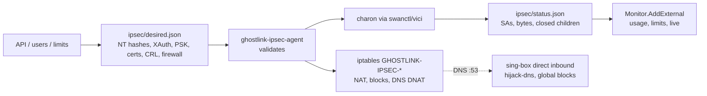
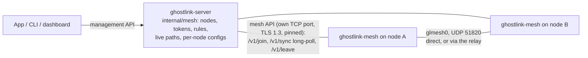

# Protocols, split tunneling, the server and the mesh

How Ghostlink supports Shadowsocks, VLESS-REALITY, WireGuard and AmneziaWG, and how split tunneling is applied. The Outline key decision is in [outline-access-keys.md](outline-access-keys.md); the original OpenVPN-era record is in [decision-record.md](decision-record.md).

## One worker, one generated configuration

Every protocol except the optional OpenVPN backend runs in the managed worker (`core/outline-worker`), which links unmodified sing-box 1.14.4. The daemon builds one sing-box configuration per connection in `core/vpn-engine/src/worker_session.rs`:

| Kind | Generated as | Tag |
|---|---|---|
| Shadowsocks | `shadowsocks` outbound | `proxy` |
| VLESS | `vless` outbound with `tls.utls` and `tls.reality` | `proxy` |
| WireGuard | sing-box native `wireguard` endpoint | `proxy` |
| AmneziaWG | Ghostlink `amneziawg` endpoint (below) | `proxy` |

- **Routing target:** `route.final` is always set to `proxy` explicitly, because sing-box only falls back to endpoints when `final` names one.
- **DNS:** WireGuard profiles with a `DNS =` resolver use it over UDP through the tunnel. Every other profile uses DNS-over-HTTPS to 1.1.1.1 through the tunnel.
- **Partial `AllowedIPs`:** a WireGuard profile that doesn't route everything becomes the TUN's `route_address` list, so only those prefixes enter the tunnel.
- **Build tags:** `with_gvisor` for the userspace stacks, `with_utls` for REALITY, `with_wireguard` for the endpoint.

`core/vpn-engine/src/access.rs` is the single entry point that turns a credential into an `Outbound`. It is used both when importing (to validate) and when connecting (to re-validate the sealed original).

## AmneziaWG endpoint

sing-box has no AmneziaWG support. Rather than fork it, `core/outline-worker/internal/awg` registers a new endpoint type, `amneziawg`, that reuses sing-box's WireGuard plumbing around unmodified **amneziawg-go v3** (`github.com/amnezia-vpn/amneziawg-go/v3`, MIT):

- **Network stack:** sing-box's exported gVisor stack device (`transport/wireguard.NewDevice`). Its `tun.Device` method set matches amneziawg-go's exactly, except for the `Event` type, which a small adapter converts.
- **Client sockets:** a bind adapted from sing-box's `ClientBind`. It sends through sing-box's dialer, so UDP binds to the physical interface and never loops back into the TUN. **It must not rewrite packet bytes.** sing-box's original overwrites bytes 1–3 for Cloudflare WARP's "reserved" field, which is exactly where AmneziaWG's magic headers sit.
- **Server sockets:** amneziawg-go's standard bind on `listen_port`. Incoming flows go to sing-box's router, with each peer's `user` attached, so `auth_user` rules apply to WireGuard/AmneziaWG users the same way as to Shadowsocks and VLESS users.
- **Configuration safety:** obfuscation values are written through amneziawg-go's UAPI from an allowlist of parameter names. Values containing `=`, CR/LF or NUL are refused, so a config cannot inject other UAPI settings.
- **Plain WireGuard:** the same endpoint with zero obfuscation parameters interoperates with a stock WireGuard client. The client side still uses sing-box's native endpoint for plain WireGuard.

Interop tests in `internal/awg` run against the real upstream peer:
- upstream amneziawg-go with legacy, 2.0 and zero parameters;
- an upstream AWG 2.0 client against our server;
- a stock WireGuard client against our server;
- per-user rules;
- a mismatched header, which must fail.

## Import formats

| Format | Parser | Notes |
|---|---|---|
| `ss://`, `ssconf://` | `outline.rs` | Modern AEAD only; dynamic keys over verified HTTPS to public hosts, pinned DNS, no redirects, 64 KiB cap |
| `vless://`, Xray JSON | `vless.rs` | `security` must be `reality` or `tls`; flow empty or `xtls-rprx-vision`; transport TCP/raw only; uTLS fingerprints map `hellochrome_*` to `chrome` |
| `.conf` | `wireguard.rs` | One `[Peer]`; AmneziaWG keys map to UAPI names; `HeaderProtectionKey` base64 → hex and requires S1–S4 ≥ 12; `RandomTrailers`/`DisableCookies` → `true`/`false`; legacy `J1`–`J3`/`Itime` ignored |
| `vpn://` | `amnezia.rs` | `vpn://` + base64url(4-byte big-endian length + zlib(JSON)). Containers `amnezia-awg2`, `amnezia-awg`, `amnezia-wireguard` and `amnezia-xray` are supported. `last_config` is a JSON *string*; its `config` text goes through `wireguard.rs` |

Always rejected:
- `.conf`: `PreUp`/`PostUp`/`PreDown`/`PostDown`, `Table`, `FwMark`, `SaveConfig`, unknown keys and malformed keys.
- `AdvancedSecurity = on`: amneziawg-tools reports it as EINVAL in userspace mode.
- Amnezia keys containing `userName`/`password`: these are full-access keys carrying the server's SSH login.
- Amnezia API/subscription keys.

## Split tunneling

The policy lives in the daemon:
- the global policy in `Store.routing_policy`;
- per-server overrides in `StoredProfile.routing_override`, which survive a `--replace` import.

It is owner-only and validated by `core/vpn-engine/src/split.rs`. The generated route rules are, in order:

1. `sniff`, so protocol (DNS) and site names (TLS SNI, HTTP Host, QUIC) are known;
2. the health proxy is pinned to `proxy`, because otherwise "only" mode would let the health check succeed without the tunnel;
3. IPv6 from the TUN is rejected;
4. DNS is hijacked;
5. the policy rules: bypass sends matches to `direct`, "only" sends them to `proxy`. App rules use `process_name`/`process_path` with `find_process`.

`final` is `proxy`, or `direct` in "only" mode. Bypassed sites resolve through the local resolver; in "only" mode, listed sites resolve through the tunnel.

"Keep LAN direct" is an `ip_is_private` rule, not a TUN route exclusion. Excluding RFC 1918 from the TUN would also exclude the TUN's own 172.28.85.0/30 DNS address. The `direct` outbound binds to the physical interface through `auto_detect_interface`.

Limits: OpenVPN profiles ignore the policy, and site rules cannot see names that are hidden (ECH, hard-coded IPs). The real-engine test `split_tunnel_rules_route_by_ip_and_site` checks full, bypass-by-IP, bypass-by-site (via Host sniffing) and "only" routing, and that the health probe stays in the tunnel.

## Ghostlink server

`cmd/ghostlink-server` and `internal/server` build on the same engines. They render the server state into one sing-box configuration (`render.go`):

| Protocol | Served as | User attribution |
|---|---|---|
| Shadowsocks | multi-user `shadowsocks` inbound (`chacha20-ietf-poly1305`, Outline-compatible) | sing-box user name |
| VLESS-REALITY | `vless` inbound with REALITY, `xtls-rprx-vision` | sing-box user name |
| WireGuard | `amneziawg` endpoint with zero obfuscation | peer `user` → `metadata.User` |
| AmneziaWG | `amneziawg` endpoint with AWG 2.0 parameters | peer `user` → `metadata.User` |

- **User names:** every user's sing-box name is `u<id>`, so rules never contain user-supplied text.
- **Inactive users:** disabled and over-limit users are left out of the inbound user lists and peer lists, so they cannot connect at all.
- **Tunnel addresses:** WireGuard and AmneziaWG clients get a /32 from `10.77.0.0/20` and `10.78.0.0/20`. The endpoint maps traffic to its own tunnel address onto loopback, which the always-on block then refuses (port 53 is hijacked to the server resolver first).
- **Route rules, in order:**
  1. sniff;
  2. hijack DNS (protocol DNS or port 53);
  3. `resolve`;
  4. always-on internal blocks;
  5. API port and own-IP blocks;
  6. per-user blocks (`auth_user`);
  7. exempt users routed `direct`;
  8. global blocks;
  9. `final: direct`.
- **DNS rules:** per-user, then exempt, then global block rules answer `NXDOMAIN`.
- **Usage:** `usage.go` is a router `ConnectionTracker`. It counts each user's bytes for connections, packet connections and pre-matched flows, and outlives engine reloads.
- **Changes:** `service.go` applies each change to a copy of the state. It restarts the engine only if the rendered configuration differs, and saves only after the engine started. `engine.go` validates a new configuration fully before closing the running instance, because the ports must be free; if the new one fails, it restarts the last good one.
- **Keys:** `keys.go` renders them. `ss://` uses SIP002 userinfo plus `outline=1`. `vless://` carries `pbk`, `sid`, `sni` and `fp=chrome`. `vpn://` uses Amnezia's qCompress layout, with no SSH fields.

The client service manages servers through `core/vpn-engine/src/server_admin.rs`:
- **TLS:** rustls, TLS 1.3, with a verifier that compares the SHA-256 of the end-entity certificate with the pin and still verifies handshake signatures.
- **Requests:** typed operations mapped to fixed paths.
- **Bypass while connected:** while a tunnel is up, `worker_session::config_with_direct` routes each managed server's API `host:port` to `direct` (by IP, or by domain plus local DNS) right after the health rule.

## Monitoring (v0.4.0)

`internal/server/monitor.go` is the router `ConnectionTracker`. For each routed connection, packet connection or pre-matched flow, it attaches counters selected from the metadata sing-box already provides:
- `User`, for up and down totals and a pending counter for data limits;
- `Inbound`, the protocol used;
- `Protocol`, the sniffed traffic type;
- `Domain` or the FQDN destination, only when site stats are on. Domains map through a small service table or else `publicsuffix`, and are capped at 500 labels per user per day.

Open connections are counted by wrappers that embed sing's counter conns, so upstream and zero-copy interfaces are kept, and they decrement once on `Close`/`CloseFlow`.

Periodic work in `service.go`:
- **Every second:** a sampler turns totals into per-user rates and a 120-sample server series.
- **Every 5 s:** a WireGuard/AmneziaWG peer poll, and the IPsec component's session report.
- **Every 30 s:** data-limit accounting, `Flush` into `history.go`, another peer poll, and a disk check.
- **Every 5 min:** a save with rotation.

The peer poll (`awg.Endpoint.PeerStatus`: UAPI `endpoint=`, `last_handshake_time_*` and `rx_bytes`) supplies real client addresses for WireGuard-family users, whose routed source is only a tunnel address, and shows whether each peer is still sending.

**Online state** (`isOnline` in `monitor.go`) means the client was seen in the last 60 s. Each user has one "last seen" time that only the client's own activity moves: a new connection or flow, an upload in a one-second sample, a download of at least 16 KB in one second (a client that has gone stops acknowledging, so a bulk transfer to it stalls within seconds), a WireGuard/AmneziaWG peer whose receive counter grew between polls (issued keys send a keepalive every 25 s) or that completed a handshake, and every IKEv2/IPsec report while a session is up. Open connections are counted but don't make a client online. A client that leaves without closing them, for example WireGuard switched off or a phone out of range, can leave them open on the server for many minutes, and remote services keep writing small amounts to them.

The dashboard (`dashboard.go` with embedded static files) serves the same API mux under `/api/` after its own session checks, and the server commands (`admin.go`) call the API over loopback. All three front ends share one implementation.

## IKEv2/IPsec for Apple devices (v0.5.0)

Apple's built-in IKEv2 and IPsec run in the kernel, so they cannot pass sing-box like the other protocols. The server keeps the model and the unprivileged role; a separate agent does the privileged work:

- **Connections:** four of them (`gl-ikev2-cert`, `gl-ikev2-eap`, `gl-ikev1-cert` and `gl-ikev1-psk` in Aggressive Mode) use fixed proposals. All are UDP-encapsulated (`encap = yes`) and draw from the pools `10.79.0.0/20` and `10.80.0.0/20`.
- **Identities:** the IKEv2 server identity is `%any`, so the identifier the device requests is answered when the server certificate carries it. Every key's remote identifier is added to that certificate.
- **Users:** identified by EAP or XAuth name, else by the certificate's identity.
- **DNS:** the pool gateways sit on the dummy `glipsec0`. DNS to any address is DNATed to a sing-box `direct` inbound (high port, allowed only from the pools), whose `hijack-dns` applies the DNS rules for everyone.
- **Accounting:** usage is counted per CHILD_SA unique ID, which survives IKE rekeys. Final counters come from `child-updown`, `ike-updown` and `child-rekey` events, so short sessions and the last seconds of a session are counted.

## Mesh of Linux servers (v0.6.0)

The mesh carries no VPN users. It is a separate layer-3 overlay between servers over **kernel WireGuard**, with the Ghostlink server as a control plane that holds no privileges:

- **Join:** the agent generates its WireGuard key and posts the invite token, its name, public key, listen port, reported endpoints and offered subnets. It gets back a node ID, a node secret and its address (the next free one in the mesh network).
- **Sync:** every call reports per-peer handshake, rx/tx and endpoint, ping RTTs, the applied generation and any error.
  - The coordinator answers at once when the node's configuration differs from the applied one, otherwise after up to 10 s, or as soon as anything changes (a join, an admin change, a path change, a node coming online or moving address).
  - A node that is not active (waiting for approval, disabled) waits the same way, unless it still has a configuration to take down. When the mesh is turned off, the port shuts down gracefully, so the waiting syncs answer `disabled` first.
  - The generation is a 53-bit hash of the configuration's content, so identical configurations never cause re-applies.
- **Per-node configuration** (`meshproto.Config`):
  - the address with the mesh prefix and the listen port;
  - peers (public key, endpoint, `AllowedIPs`, keepalive 25 s);
  - routes to other nodes' shared subnets; the relay role; its own shared subnets with masquerade;
  - compiled firewall rules (open, ping, allow-list of source CIDRs × destination CIDRs × protocol × ports);
  - the `/etc/hosts` names.
  - The agent validates all of it before applying.
- **Endpoints:** for each viewer and target the coordinator chooses:
  1. the target's private address, when both connect from the same public address;
  2. a public address the target reported;
  3. the address the coordinator sees the target connect from, with the target's listen port;
  4. a private address, when neither is public (a LAN-only mesh).
  5. Otherwise none: the target connects out.
- **Paths:** a pair starts direct. Tick decides every 5 s.
  - It is relayed when neither side has an endpoint for the other, or when no handshake is younger than 3 minutes once 90 s have passed. The 90 s count from when both nodes are online and have applied a configuration.
  - Relaying moves the far node's `AllowedIPs` into the relay peer on both sides. Each side keeps the far node as a probe: a peer with its endpoint and keepalive but no `AllowedIPs`. A handshake on the probe since the pair was relayed makes it direct again. There is no timed retry, so traffic never leaves the relay for a direct path that does not work.
  - The relay has IP forwarding on, and its FWD chain allows mesh-to-mesh traffic between relayed peers, but only with the node's local consent.
- **Firewall on each node:**
  - `GHOSTLINK-MESH-IN` (INPUT from `glmesh0`): established traffic, ping when allowed, then the compiled rules for the node's address and its own addresses in its shared subnets (or everything when the mesh has no rules), then drop.
  - `GHOSTLINK-MESH-FWD` (FORWARD from `glmesh0`): established traffic; connections DNATed from the node's mesh address (published container ports), under the node's rules matched by the original destination and port; on a relay, traffic back out of `glmesh0` to the relayed peer. Mesh traffic to the node's shared subnets passes under the same rules; anything else is dropped.
  - `GHOSTLINK-MESH-OUT` (FORWARD into `glmesh0`): replies going back into the mesh.
  - `GHOSTLINK-MESH-POST`: masquerade from the mesh into shared subnets. `GHOSTLINK-MESH-MSS`: MSS clamping on `glmesh0`.
  - They are written with `iptables-<nft|legacy>-restore --noflush` through `internal/hostfw`, as the IPsec agent does, before the interface is configured. The backend is the one the host's `iptables` command uses. Every 30 s the agent checks its jumps and, if one is missing, restores the chains and jumps.
- **Map data:** `GET /mesh/topology` returns node views (status, online within 30 s, in sync, endpoint, seen-from, routes, version, error, rates) and link views (path, via, RTT from pings, handshake age, and rates: what node A receives from and sends to node B). All of it is live in memory and none is stored.

## Process notes

- **Close race in the TUN adapter:** the adapter (`internal/awg/tun.go`) makes `Close` wait for writes in flight and refuses later writes. amneziawg-go closes the TUN before stopping peers, and sing-box's stack dereferences a detached dispatcher on a late write. This crashed an AmneziaWG client on Linux CI and would have crashed the server on reloads.

- The worker ignores `SIGPIPE` on Unix (`sigpipe_unix.go`). A broken status pipe returns an error instead of killing the worker before its graceful engine shutdown.
- Status events are fixed JSON codes; upstream logs stay disabled so no credential or address reaches the daemon.
